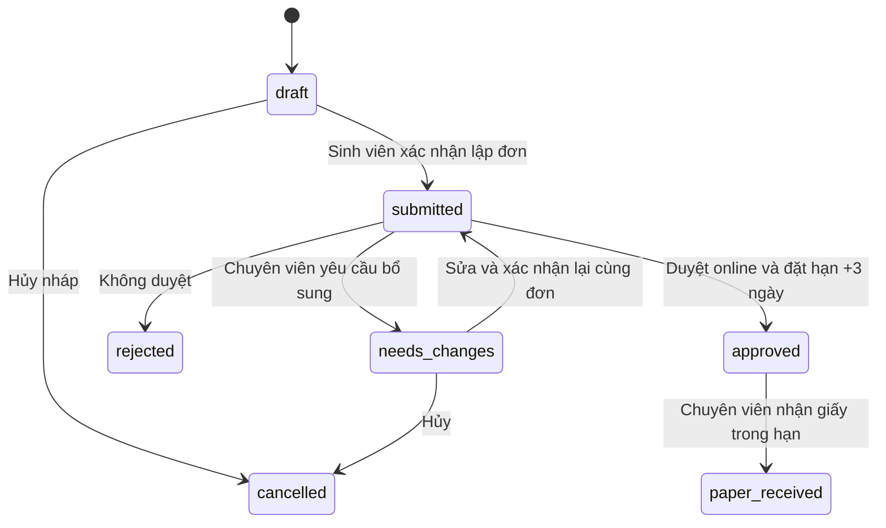

# Đơn ngừng học và gia hạn ngừng học

Luồng đang triển khai nằm trong `src/modules/academic-leave/`, API ở backend
cổng 3003. FE test sinh viên/chuyên viên cùng dùng `/academic-leave.html` ở cổng
5173/5174. Phần lập đơn không chạy qua server FE local như trang chẩn đoán dữ liệu.

## Yêu cầu đã chốt

- Bốn lý do: chữa bệnh, tai nạn, thực hiện nghĩa vụ quân sự, thai sản.
- Học kỳ bắt đầu chỉ gồm kỳ trước, kỳ hiện tại và kỳ sau; dùng hai học kỳ chính
  mỗi năm, không tính kỳ hè trong thời lượng ngừng học.
- Mỗi lần đề nghị ngừng học hoặc gia hạn chọn từ 1 đến 4 kỳ.
- Học kỳ hiện tại đọc `DATA_GVien1.dbo.tmConfig`, `VarName='optIDCode'`, cột
  `VarString1`. Nguồn hiện trả `2610`, nên ba lựa chọn là `2520`, `2610`, `2620`.
  Không cố định các mã này trong code. Cấu hình thiếu/trùng/không phải kỳ chính
  thì báo chưa xác định được kỳ; không tự đoán theo ngày máy chủ.
- Gia hạn chỉ liên kết đơn tạo trên hệ thống mới, đã duyệt online hoặc đã nhận
  bản giấy, cùng chủ sở hữu. Kỳ gia hạn nối tiếp kỳ cuối của đơn trước.
- Một đơn trước chỉ có một đơn gia hạn chưa hủy/chưa bị từ chối. Có thể tiếp tục
  chuỗi gia hạn bằng cách liên kết tới đơn gia hạn đã duyệt gần nhất. Giới hạn
  4 kỳ áp dụng từng lần, chưa đặt thêm giới hạn tổng số kỳ hoặc số lần gia hạn.
- Duyệt online tạo hạn nộp bản giấy **3 ngày (72 giờ)** sau thời điểm duyệt,
  gồm cả cuối tuần. Chuyên viên không nhập/sửa hạn bằng request.

## DB

Migration: `docs/sql/academic-leave.sql`, đã tạo trong DB local cấu hình hiện tại
`Studentpage`. Chỉ một bảng: `academic_leave.Applications`.

| Nhóm | Cột |
| --- | --- |
| Định danh/chủ sở hữu | `Id`, `StudentSequence`, `RequestCode` tính từ MSSV + số thứ tự, `StudentCode`, `ActorSource`, `ActorReference` |
| Nội dung | `Kind`, `ParentApplicationId`, `ReasonCode`, `StartSemesterCode`, `SemesterCount`, `Content` |
| Dữ liệu để in | `SnapshotJson`, `StudentConfirmedAt` |
| Chuyên viên xử lý | `Status`, `ReviewerReference`, `ReviewerName`, `ReviewNote`, `ReviewedAt` |
| Bản giấy | `PaperDeadlineAt`, `PaperReceivedAt`, `PaperReceivedBy` |
| Cập nhật | `CreatedAt`, `UpdatedAt`, `RowVersion` |

FK `(ParentApplicationId,StudentCode) → (Id,StudentCode)` ràng buộc đơn gia hạn
cùng MSSV. Service kiểm tra thêm tài khoản sở hữu và trạng thái đơn trước.
CHECK bảo vệ số kỳ 1–4, bốn lý do, loại đơn/đơn cha, trạng thái, JSON hợp lệ,
hạn duyệt +3 ngày và thời điểm nhận giấy trong hạn. Unique index ngăn một sinh
viên có nhiều đơn đang nháp/chờ duyệt/cần bổ sung cùng lúc, và ngăn gia hạn trùng
đơn cha. Không ghi vào `tmNgungTroLaiHoc` hoặc các DB trường.

Đã đối chiếu cấu trúc gốc `DATA_GVien1.dbo.tmNgungTroLaiHoc`: `MaDeNghi`,
`MaSV`, `LyDoNgung`, `SoKyNgung`, `NgungTuKy`, `XacNhanNgung`, các nhóm duyệt,
nhận đơn và gia hạn 1/2. Bảng mới phục vụ workflow đã yêu cầu, dùng FK cho gia
hạn thay vì tạo thêm nhóm cột cho mỗi lần. Chưa nhập đơn cũ hoặc đồng bộ quyết định.

Mã đơn có dạng `NH` + MSSV 9 chữ số + `StudentSequence`: `NH1022303771`,
`NH1022303772`... Mỗi MSSV mới bắt đầu từ 1; ngừng học và gia hạn dùng chung dãy
số của sinh viên. Cấp số trong transaction bằng MAX + 1 với khóa range trên
index unique `(StudentCode,StudentSequence)`, không dựa vào ID chung. Sửa/in lại
không cấp số mới; đơn hủy/không duyệt vẫn giữ số để không tái sử dụng mã đã cấp.
Migration bổ sung giữ nguyên mã của các đơn đã có bằng cách lưu hậu tố cũ vào
StudentSequence, rồi tiếp tục sau số cao nhất. Không đánh lại mã đơn đã xác nhận.

## Trạng thái



`approved` xác nhận hồ sơ online hợp lệ để nộp trực tiếp, chưa phải quyết định
cho phép ngừng học của Nhà trường. Đơn quá hạn giữ trạng thái approved, trả thêm
`overdue:true` và chặn nhận giấy; không tự xóa đơn. Chưa có luồng cấp/gia hạn
thời hạn ngoại lệ hoặc phát hành số quyết định.

## Nguồn dữ liệu và bản in

Xác thực DUT SSO và lấy profile dùng chung tại module `students`, được module
certifications tái sử dụng qua public entry point. Profile cung cấp họ tên,
MSSV, ngày sinh, điện thoại, lớp. CCCD tra `DATA_SV1.dbo.NhanThan.CCCD_So` bằng
MSSV của profile; chỉ dự phòng `cmnd` khi là 12 chữ số. Điểm đọc từ
`https://xemdiem.dut.udn.vn/api/stats` với cùng DUT token.

Lúc xác nhận lập đơn, backend lấy lại dữ liệu, kiểm tra đủ trường cá nhân và lưu
`SnapshotJson`. Bản in về sau dùng snapshot này; đổi profile/điểm không tự sửa
đơn đã xác nhận. Khi chuyên viên yêu cầu bổ sung, sinh viên sửa và xác nhận lại
cùng đơn, snapshot được cập nhật và kết quả duyệt cũ được xóa. Không lưu lịch sử
từng phiên bản thành bảng riêng.

Snapshot chứa các học kỳ sau bước validate; **ba học kỳ lựa chọn chỉ áp dụng kỳ
bắt đầu**, không cắt bảng điểm thành ba dòng. Bộ xử lý tại
`students/validators/academic-statistics.validator.js` ghép đủ các cột trước khi
lọc trùng. Kỳ hè `XX21` đã nằm trong kỳ 2 `XX20`: giữ bản ghi `XX20`, bỏ `XX21`,
không cộng tín chỉ/điểm hoặc tính lại GPA. Ví dụ `2320/2321`, `2420/2421`,
`2520/2521` trở thành 3 dòng kỳ 2. Ưu tiên kỳ chính dù thứ tự API đảo hoặc số liệu
hè khác kỳ chính. Nếu chỉ có `XX21`, giữ số liệu đó dưới mã `XX20` để không mất
một kỳ dữ liệu; không tạo thêm số liệu giả. Các năm khác nhau luôn được giữ riêng.

Giữ nguyên null/0; từ chối mảng khác số phần tử và số không hợp lệ. Các dòng kỳ
chính trùng hoàn toàn được lấy một lần; nếu cùng kỳ chính có kết quả khác nhau
thì báo cần đối chiếu nguồn, không tự chọn một điểm. Hỗ trợ cả mã kỳ và nhãn
hiển thị kiểu `2 / 2023-2024` trong snapshot cũ.

Đơn xác nhận mới lưu sẵn các dòng đã chuẩn hóa. Chi tiết/HTML/PDF của đơn đã có
cũng dùng cùng bộ xử lý khi đọc snapshot, không ghi lại snapshot hay đổi mã,
RowVersion, ngày xác nhận hoặc kết quả duyệt chỉ vì in lại. Ví dụ 10 dòng trong
ảnh người dùng cung cấp trở thành 7 dòng sau khi bỏ 3 kỳ hè trùng.
Cột “Điểm TBC học tập” trong mẫu lấy `GPA từng kỳ` của API; ý nghĩa GPA học kỳ
hay tích lũy vẫn cần chủ nghiệp vụ xác nhận trước khi dùng bản in chính thức.

Mẫu in dựng từ hình người dùng cung cấp, gồm thông tin cá nhân, bảng học kỳ,
nội dung tự ghép từ loại đơn/số kỳ/kỳ bắt đầu/lý do, nội dung bổ sung, chỗ ký và
biên nhận để chuyên viên ký khi nhận hồ sơ giấy. HTML escape mọi dữ liệu nguồn
và người dùng. Link trường chuyển về `/Default.aspx` khi không có phiên đăng nhập.

Mẫu nằm trong code, không lưu HTML hay file PDF trong DB. Mở/in lại chỉ đọc mã
đơn và snapshot, không tạo bản ghi in, không tăng số đơn hoặc sửa RowVersion.
PDF dựng theo yêu cầu rồi trả trực tiếp, không upload R2 hay ghi file vào DB.

## API

Sinh viên dùng `Authorization: Bearer <DUT SSO token>`. Không nhận MSSV, thông tin
cá nhân, snapshot, status hoặc hạn giấy trong body. Chuyên viên cần adapter xác
thực riêng được truyền vào module; khi thiếu adapter, route chuyên viên trả 503.
Môi trường local dùng chung session chuyên viên admin của FE certification.

| Method | Path sau `/api/academic-leave` | Chức năng |
| --- | --- | --- |
| POST | `/print-session` | Sinh viên cấp quyền mở PDF cho mã MADN đã xác nhận |
| POST | `/reviewer/print-session` | Chuyên viên cấp quyền mở PDF cho mã MADN |
| GET | `/print?MADN=NH1022303771` | PDF A4, Content-Type application/pdf, mở inline |
| GET | `/form` | Thông tin điền sẵn, bốn lý do, ba kỳ, giới hạn kỳ và đơn cha hợp lệ |
| GET | `/applications?page=1&status=submitted` | Đơn của tài khoản hiện tại, 20 dòng/trang |
| POST | `/applications` | Lưu đơn nháp |
| GET | `/applications/:id` | Chi tiết và rowVersion |
| PUT | `/applications/:id` | Sửa nháp/đơn cần bổ sung |
| POST | `/applications/:id/confirm` | Chốt dữ liệu và gửi chuyên viên |
| GET | `/applications/:id/print` | HTML in từ snapshot, sau khi xác nhận |
| POST | `/applications/:id/cancel` | Hủy nháp/đơn cần bổ sung |
| GET | `/reviewer/applications` | Danh sách cho chuyên viên, cùng phân trang/filter |
| GET | `/reviewer/applications/:id` | Chi tiết cho chuyên viên |
| GET | `/reviewer/applications/:id/print` | Bản in cho chuyên viên |
| POST | `/reviewer/applications/:id/review` | Duyệt/yêu cầu bổ sung/không duyệt |
| POST | `/reviewer/applications/:id/receive-paper` | Ghi thời điểm/người nhận đơn giấy |

PUT và các POST cập nhật đơn đã có bắt buộc `If-Match: "<rowVersion>"` từ lần
tải gần nhất; thiếu trả 428, cũ hoặc trạng thái không phù hợp trả 409. Cập nhật
dùng khóa/transaction và rowversion trong SQL. Xác nhận đơn chặn khoảng ngừng
học trùng các đơn đã nộp/duyệt/nhận giấy của cùng MSSV.

Ví dụ lưu nháp:

```json
{"kind":"leave","parentApplicationId":null,"reasonCode":"medical","startSemesterCode":"2610","semesterCount":2,"content":"Thông tin bổ sung"}
```

Gia hạn dùng `kind:"extension"` và `parentApplicationId` của đơn trước. Xác nhận,
hủy và nhận giấy gửi `{}`. Xét duyệt gửi
`{"decision":"approved","note":"Hồ sơ hợp lệ"}`; `needs_changes`/`rejected` bắt
buộc note.

## Mở link PDF và cấu hình renderer

Sau khi xác nhận, response trả `printUrl`, ví dụ:
`/api/academic-leave/print?MADN=NH1022303771`.

FE POST `/print-session` (hoặc `/reviewer/print-session`) với
`{"MADN":"NH1022303771"}` bằng phiên đăng nhập hiện tại và credentials include.
Server kiểm tra chủ sở hữu/quyền chuyên viên, đặt cookie HttpOnly, SameSite Strict,
chỉ dùng cho đường dẫn `/api/academic-leave/print`, hết hạn sau 5 phút và chỉ cho
mã đơn/phiên xác nhận đó. Cookie không chứa DUT bearer token hoặc dữ liệu cá nhân
của snapshot. Sau đó tab mới mở đúng `printUrl`, hiển thị trình xem PDF có nút
in/tải. Link không có SSO token, không phải Blob URL. Khi quyền in hết hạn, bấm
In đơn trong phiên đang đăng nhập để cấp lại; mã/link đơn vẫn giữ nguyên.

GET `/print?MADN=...` cũng nhận Bearer token DUT cho API client. Biết hoặc đổi
MADN không cho phép đọc đơn của người khác. Cookie cũ bị từ chối nếu sinh viên
đã xác nhận lại đơn sau yêu cầu bổ sung. FE/API cần cùng site để gửi cookie
SameSite Strict; cấu hình local localhost hai cổng đáp ứng điều này.

PDF dùng `puppeteer-core` và Chromium/Chrome/Edge đã cài trên BE. Windows tự tìm
Edge/Chrome; máy khác cấu hình `PDF_BROWSER_EXECUTABLE` bằng đường dẫn tuyệt đối
và cài font hỗ trợ tiếng Việt. Gói npm không tải browser. Browser dùng riêng cho
PDF, không đăng nhập, không có DUT token; JavaScript và request tài nguyên ngoài
bị chặn. Tối đa 1 tác vụ render và 8 tác vụ chờ trong process; quá tải trả 503
Retry-After, browser nhàn rỗi đóng sau 30 giây và đóng khi BE shutdown.

`LEAVE_PRINT_COOKIE_SECRET` tùy chọn, tối thiểu 32 byte nếu cấu hình; dùng chung
khi chạy nhiều BE instance. Để trống dùng khóa ngẫu nhiên trong process, nên
restart sẽ cần bấm In đơn lại. Cookie bật Secure khi NODE_ENV=production.

Tham khảo cơ chế PDF: [Puppeteer Page.pdf](https://pptr.dev/api/puppeteer.page.pdf).

## Kiểm thử

```powershell
node --test tests/integration/academic-leave.test.js tests/architecture.test.js
$env:LEAVE_DB_TEST='1'
node --test tests/integration/academic-leave-sql.test.js
$env:PDF_BROWSER_TEST='1'
node --test tests/integration/academic-leave-pdf.test.js
```

SQL test dùng schema riêng, dữ liệu sinh viên giả, rồi tự dọn. Bao phủ tạo/sửa/
xác nhận/in, giữ snapshot, quyền sở hữu, rowversion, yêu cầu bổ sung, duyệt +72
giờ, nhận giấy, gia hạn 4 kỳ và FK, trùng thời gian, quá hạn và CHECK số kỳ.
Đã bổ sung cấp số theo từng MSSV, tạo đồng thời, migration giữ mã/snapshot cũ,
query PDF có phân quyền và xác nhận việc in không cập nhật DB. Test browser PDF
thật xác minh mẫu 10 dòng học kỳ và biên nhận nằm trong 1 trang A4. File PDF mẫu
trong `.data` chỉ là artifact kiểm thử bằng dữ liệu giả, không phải cách lưu đơn.
