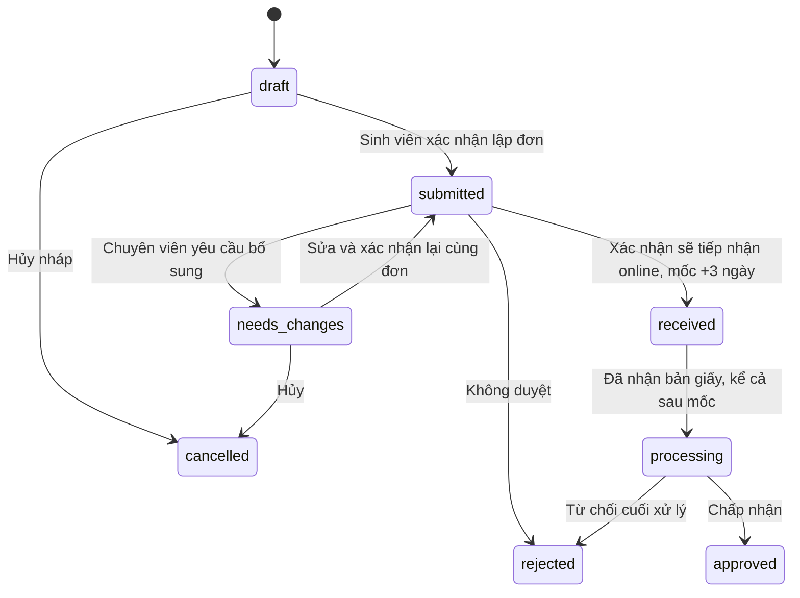

# Đơn ngừng học và gia hạn ngừng học

Luồng đang triển khai nằm trong [module common](../src/common/academic-leave/), API ở backend
cổng 3003. FE test sinh viên/chuyên viên cùng dùng `/academic-leave.html` ở cổng
5173/5174. Phần lập đơn không chạy qua server FE local như trang chẩn đoán dữ liệu.

## Yêu cầu đã chốt

- Bốn lý do: chữa bệnh, tai nạn, thực hiện nghĩa vụ quân sự, thai sản.
- Học kỳ bắt đầu chỉ là học kỳ hiện tại; dùng hai học kỳ chính
  mỗi năm, không tính kỳ hè trong thời lượng ngừng học.
- Mỗi lần ngừng học/gia hạn chọn 1 kỳ; riêng nghĩa vụ quân sự được 1–4 kỳ. Trở lại học có `semesterCount=0`.
- Học kỳ hiện tại đọc `DATA_GVien1.dbo.tmConfig`, `VarName='optIDCode'`, cột
  `VarString1`. Form chỉ trả học kỳ chính hiện tại từ nguồn.
  Không cố định các mã này trong code. Cấu hình thiếu/trùng/không phải kỳ chính
  thì báo chưa xác định được kỳ; không tự đoán theo ngày máy chủ.
- Gia hạn/trở lại học chỉ liên kết đơn đã chấp nhận cuối cùng (`approved`), cùng
  chủ sở hữu. Kỳ gia hạn nối tiếp kỳ cuối của đơn trước.
- Một đơn trước chỉ có một đơn gia hạn chưa hủy/chưa bị từ chối. Có thể tiếp tục
  chuỗi gia hạn bằng cách liên kết tới đơn gia hạn đã duyệt gần nhất. Giới hạn
  4 kỳ áp dụng từng lần, chưa đặt thêm giới hạn tổng số kỳ hoặc số lần gia hạn.
- Xác nhận sẽ tiếp nhận online ghi mốc nộp bản giấy **+3 ngày** và chuyển `received`.
  Chưa nộp giấy thì giữ trạng thái này, kể cả qua mốc; không khóa nhận giấy muộn.

## DB

DB local có `academic_leave.Applications` và `academic_leave.ApplicationHistory`.
Khởi tạo bằng `npm run academic-leave:db:init`; nâng cấp DB đã có bằng
`npm run db:review-workflow:upgrade`. Xem [migration workflow](CERTIFICATIONS_ACADEMIC_LEAVE_WORKFLOW.md#nâng-cấp-db-local).

| Nhóm | Cột |
| --- | --- |
| Định danh/chủ sở hữu | `Id`, `StudentSequence`, `RequestCode` tính từ MSSV + số thứ tự, `StudentCode`, `ActorSource`, `ActorReference` |
| Nội dung | `Kind`, `ParentApplicationId`, `ReasonCode`, `StartSemesterCode`, `SemesterCount`, `Content` |
| Dữ liệu để in | `SnapshotJson`, `StudentConfirmedAt` |
| Chuyên viên xử lý | `Status`, `ReviewerReference`, `ReviewerName`, `ReviewNote`, `ReviewedAt` |
| Tiếp nhận/bản giấy | `ReceivedAt`, `PaperDeadlineAt` (mốc +3 ngày), `PaperReceivedAt`, `PaperReceivedBy` |
| Cập nhật | `CreatedAt`, `UpdatedAt`, `RowVersion` |

FK `(ParentApplicationId,StudentCode) → (Id,StudentCode)` ràng buộc đơn gia hạn
cùng MSSV. Service kiểm tra thêm tài khoản sở hữu và trạng thái đơn trước.
CHECK bảo vệ số kỳ 1–4, bốn lý do, loại đơn/đơn cha, trạng thái, JSON hợp lệ,
mốc +3 ngày và thời điểm nhận giấy không trước lúc xác nhận sẽ tiếp nhận. Transaction
khóa theo sinh viên ngăn tạo thêm đơn khi còn nháp/chờ xét/chờ giấy/đang xử lý;
unique index bảo vệ nháp/chờ xét/cần bổ sung và đơn kế tiếp trùng cha.
Không ghi vào `tmNgungTroLaiHoc` hoặc các DB trường.

Đã đối chiếu cấu trúc gốc `DATA_GVien1.dbo.tmNgungTroLaiHoc`: `MaDeNghi`,
`MaSV`, `LyDoNgung`, `SoKyNgung`, `NgungTuKy`, `XacNhanNgung`, các nhóm duyệt,
nhận đơn và gia hạn 1/2. Bảng mới phục vụ workflow đã yêu cầu, dùng FK cho gia
hạn thay vì tạo thêm nhóm cột cho mỗi lần. Chưa nhập đơn cũ hoặc đồng bộ quyết định.

Mã đơn có dạng `NH` + MSSV 9 chữ số + `StudentSequence`: `NH1022303771`,
`NH1022303772`... Mỗi MSSV mới bắt đầu từ 1; ngừng học và gia hạn dùng chung dãy
số của sinh viên. Cấp số trong transaction bằng MAX + 1 với khóa range trên
index unique `(StudentCode,StudentSequence)`, không dựa vào ID chung. Sửa/in lại
không cấp số mới; đơn hủy/không duyệt vẫn giữ số để không tái sử dụng mã đã cấp.
Migration bổ sung giữ nguyên mã của các đơn đã có bằng cách lưu hậu tố cũ vào
StudentSequence, rồi tiếp tục sau số cao nhất. Không đánh lại mã đơn đã xác nhận.

## Trạng thái



`received` là chờ giấy, `processing` là đã nhận giấy và đang xử lý, `approved` là
chấp nhận cuối cùng. Chỉ từ chối ở `submitted` hoặc `processing`, không từ chối
trong lúc chờ giấy. Qua mốc vẫn `received`, `overdue:true` chỉ để hiển thị;
không tự xóa/từ chối hoặc chặn nhận giấy. Chưa tự phát hành số quyết định.

## Nguồn dữ liệu và bản in

Xác thực DUT SSO và lấy profile dùng chung tại module `students`, được module
certifications tái sử dụng qua public entry point. Profile cung cấp họ tên,
MSSV, ngày sinh, điện thoại, lớp. CCCD tra `DATA_SV1.dbo.NhanThan.CCCD_So` bằng
MSSV của profile; chỉ dự phòng `cmnd` khi là 12 chữ số. Điểm đọc từ
`https://xemdiem.dut.udn.vn/api/stats` với cùng DUT token.

Lúc xác nhận lập đơn, backend lấy lại dữ liệu, kiểm tra đủ trường cá nhân và lưu
`SnapshotJson`. Bản in về sau dùng snapshot này; đổi profile/điểm không tự sửa
đơn đã xác nhận. Khi chuyên viên yêu cầu bổ sung, sinh viên sửa và xác nhận lại
cùng đơn, snapshot được cập nhật và kết quả duyệt hiện tại được xóa; lịch sử
thao tác/snapshot vẫn giữ trong `ApplicationHistory` ở DB local.

Snapshot chứa các học kỳ sau bước validate; lựa chọn học kỳ bắt đầu không cắt
bảng điểm. Bộ xử lý tại
`students/validators/academic-statistics.validator.js` ghép đủ các cột trước khi
lọc trùng. Kỳ hè `XX21` đã nằm trong kỳ 2 `XX20`: giữ bản ghi `XX20`, bỏ `XX21`,
không cộng tín chỉ/điểm hoặc tính lại GPA. Ví dụ `2320/2321`, `2420/2421`,
`2520/2521` trở thành 3 dòng kỳ 2. Ưu tiên kỳ chính dù thứ tự API đảo hoặc số liệu
hè khác kỳ chính. Nếu chỉ có `XX21`, giữ số liệu đó dưới mã `XX20` để không mất
một kỳ dữ liệu; không tạo thêm số liệu giả. Các năm khác nhau luôn được giữ riêng.

Giữ nguyên null/0; từ chối mảng khác số phần tử và số không hợp lệ. Các dòng kỳ
chính trùng hoàn toàn được lấy một lần; nếu cùng kỳ chính có kết quả khác nhau
thì báo cần đối chiếu nguồn, không tự chọn một điểm. Hỗ trợ cả mã kỳ và nhãn
hiển thị kiểu `2 / 2023-2024` trong snapshot cũ.

Đơn xác nhận mới lưu sẵn các dòng đã chuẩn hóa. Chi tiết/HTML/PDF của đơn đã có
cũng dùng cùng bộ xử lý khi đọc snapshot, không ghi lại snapshot hay đổi mã,
RowVersion, ngày xác nhận hoặc kết quả duyệt chỉ vì in lại. Ví dụ 10 dòng trong
ảnh người dùng cung cấp trở thành 7 dòng sau khi bỏ 3 kỳ hè trùng.
Cột “Điểm TBC học tập” trong mẫu lấy `GPA từng kỳ` của API; ý nghĩa GPA học kỳ
hay tích lũy vẫn cần chủ nghiệp vụ xác nhận trước khi dùng bản in chính thức.

Mẫu in dựng từ hình người dùng cung cấp, gồm thông tin cá nhân, bảng học kỳ,
nội dung tự ghép từ loại đơn/số kỳ/kỳ bắt đầu/lý do, nội dung bổ sung, chỗ ký và
biên nhận để chuyên viên ký khi nhận hồ sơ giấy. HTML escape mọi dữ liệu nguồn
và người dùng. Link trường chuyển về `/Default.aspx` khi không có phiên đăng nhập.

Mẫu nằm trong code, không lưu HTML hay file PDF trong DB. Mở/in lại chỉ đọc mã
đơn và snapshot, không tạo bản ghi in, không tăng số đơn hoặc sửa RowVersion.
PDF dựng theo yêu cầu rồi trả trực tiếp, không upload R2 hay ghi file vào DB.

## API

Sinh viên dùng `Authorization: Bearer <DUT SSO token>`. Không nhận MSSV, thông tin
cá nhân, snapshot, status hoặc mốc giấy trong body. Chuyên viên đăng nhập tài khoản
auth local, cần task 3 và quyền `academic-leave:review`; admin phòng DT chỉ GET.
Môi trường local dùng chung phiên `/api/admin/auth` với FE certification.

| Method | Path sau `/api/academic-leave` | Chức năng |
| --- | --- | --- |
| POST | `/print-session` | Sinh viên cấp quyền mở PDF cho mã MADN đã xác nhận |
| POST | `/reviewer/print-session` | Chuyên viên cấp quyền mở PDF cho mã MADN |
| GET | `/print?MADN=NH1022303771` | PDF A4, Content-Type application/pdf, mở inline |
| GET | `/form` | Thông tin điền sẵn, bốn lý do, kỳ hiện tại, giới hạn kỳ và đơn cha hợp lệ |
| GET | `/applications?page=1&status=submitted` | Đơn của tài khoản hiện tại, 20 dòng/trang |
| POST | `/applications` | Lưu đơn nháp |
| GET | `/applications/:id` | Chi tiết và rowVersion |
| PUT | `/applications/:id` | Sửa nháp/đơn cần bổ sung |
| POST | `/applications/:id/confirm` | Chốt dữ liệu và gửi chuyên viên |
| GET | `/applications/:id/print` | HTML in từ snapshot, sau khi xác nhận |
| POST | `/applications/:id/cancel` | Hủy nháp/đơn cần bổ sung |
| GET | `/reviewer/applications` | Danh sách cho chuyên viên, cùng phân trang/filter |
| GET | `/reviewer/applications/:id` | Chi tiết cho chuyên viên |
| GET | `/reviewer/applications/:id/print` | Bản in cho chuyên viên |
| POST | `/reviewer/applications/:id/review` | Duyệt/yêu cầu bổ sung/không duyệt |
| POST | `/reviewer/applications/:id/receive-paper` | Ghi thời điểm/người nhận đơn giấy |

PUT và các POST cập nhật đơn đã có bắt buộc `If-Match: "<rowVersion>"` từ lần
tải gần nhất; thiếu trả 428, cũ hoặc trạng thái không phù hợp trả 409. Cập nhật
dùng khóa/transaction và rowversion trong SQL. Xác nhận đơn chặn khoảng ngừng
học trùng các đơn đã nộp/duyệt/nhận giấy của cùng MSSV.

Ví dụ lưu nháp:

```json
{"kind":"leave","parentApplicationId":null,"reasonCode":"medical","startSemesterCode":"2610","semesterCount":1,"content":"Thông tin bổ sung"}
```

Gia hạn dùng `kind:"extension"` và `parentApplicationId` của đơn trước. Xác nhận,
hủy và nhận giấy gửi `{}`. Khi `submitted`, gửi `decision:"received"` để xác nhận
sẽ tiếp nhận online, hoặc `needs_changes`/`rejected`. Khi `processing`, gửi
`{"decision":"approved","note":"Hồ sơ hợp lệ"}` hoặc `rejected`.
`needs_changes`/`rejected` bắt buộc note; mọi thay đổi dùng `If-Match`.

## Mở link PDF và cấu hình renderer

Sau khi xác nhận, response trả `printUrl`, ví dụ:
`/api/academic-leave/print?MADN=NH1022303771`.

FE POST `/print-session` (hoặc `/reviewer/print-session`) với
`{"MADN":"NH1022303771"}` bằng phiên đăng nhập hiện tại và credentials include.
Server kiểm tra chủ sở hữu/quyền chuyên viên, đặt cookie HttpOnly, SameSite Strict,
chỉ dùng cho đường dẫn `/api/academic-leave/print`, hết hạn sau 5 phút và chỉ cho
mã đơn/phiên xác nhận đó. Cookie không chứa DUT bearer token hoặc dữ liệu cá nhân
của snapshot. Sau đó tab mới mở đúng `printUrl`, hiển thị trình xem PDF có nút
in/tải. Link không có SSO token, không phải Blob URL. Khi quyền in hết hạn, bấm
In đơn trong phiên đang đăng nhập để cấp lại; mã/link đơn vẫn giữ nguyên.

GET `/print?MADN=...` cũng nhận Bearer token DUT cho API client. Biết hoặc đổi
MADN không cho phép đọc đơn của người khác. Cookie cũ bị từ chối nếu sinh viên
đã xác nhận lại đơn sau yêu cầu bổ sung. FE/API cần cùng site để gửi cookie
SameSite Strict; cấu hình local localhost hai cổng đáp ứng điều này.

PDF dùng `puppeteer-core` và Chromium/Chrome/Edge đã cài trên BE. Windows tự tìm
Edge/Chrome; máy khác cấu hình `PDF_BROWSER_EXECUTABLE` bằng đường dẫn tuyệt đối
và cài font hỗ trợ tiếng Việt. Gói npm không tải browser. Browser dùng riêng cho
PDF, không đăng nhập, không có DUT token; JavaScript và request tài nguyên ngoài
bị chặn. Tối đa 1 tác vụ render và 8 tác vụ chờ trong process; quá tải trả 503
Retry-After, browser nhàn rỗi đóng sau 30 giây và đóng khi BE shutdown.

`LEAVE_PRINT_COOKIE_SECRET` tùy chọn, tối thiểu 32 byte nếu cấu hình; dùng chung
khi chạy nhiều BE instance. Để trống dùng khóa ngẫu nhiên trong process, nên
restart sẽ cần bấm In đơn lại. Cookie bật Secure khi NODE_ENV=production.

Tham khảo cơ chế PDF: [Puppeteer Page.pdf](https://pptr.dev/api/puppeteer.page.pdf).

## Kiểm thử

```powershell
npm test
npm run check
```

Test offline kiểm tra hai mốc từ chối, không từ chối khi chờ giấy, nhận giấy muộn,
không bỏ bước, quyền chuyên viên/admin, phiên bản, dữ liệu local và điều kiện đơn
gốc. Batch migration/SQL guard được kiểm tra với dependency giả; chưa xác minh
migration trên SQL Server thật. Không tự chạy migration, seed hay ghi DB trường.

## Quy t?c th?i h?n v? DB local

Xem [quy t?c th?i h?n ch?ng ch?/h?c v?](REQUEST_REGULATIONS.md) v? m?c ti?p nh?n, x? l?, tr? k?t qu? v? tag qu? h?n trong API danh s?ch/chi ti?t. B? [Database_newversion](../Database_newversion/README.md) ch?a c?u tr?c, danh m?c DB local v? h??ng d?n d?ng m?i tr??ng.
