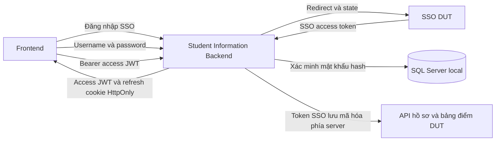

# Authentication của Student Information

Backend hỗ trợ SSO DUT và tài khoản local. Cả hai nhận access JWT và refresh JWT
do backend này ký bằng `JWT_SECRET`. Khóa SSO chỉ dùng để xác minh token do SSO
phát hành, không dùng để ký token web và không ghép hai khóa với nhau.



## Nguồn tài khoản và phân quyền

- SSO quyết định tài khoản trường. Backend không truy vấn bảng mật khẩu trường,
  không tạo tài khoản local tương ứng và không gọi endpoint cấp token đăng ký
  tín chỉ. Việc đăng nhập không ghi đè phiên Course Registration.
- Tài khoản mật khẩu nằm trong `auth.LocalAccounts` của database `LOCAL_DB_NAME`.
  Schema không tự tạo tài khoản, mật khẩu mặc định hoặc endpoint đăng ký công khai.
- SSO chỉ mở phiên kênh `student`; đường dẫn `admin` không cấp quyền admin qua SSO.
  Hồ sơ sinh viên được xác minh thêm bằng API profile của DUT khi dùng nghiệp vụ.
- Tài khoản local có `Channel`, roles và permissions do người quản trị cấp trong
  DB. Không nhận quyền từ body đăng nhập hay role trong token SSO.
- Mỗi request và refresh của tài khoản local kiểm tra lại trạng thái và rowversion
  DB. Khóa tài khoản hoặc cập nhật tài khoản/mật khẩu/quyền sẽ làm phiên cũ bị từ chối.
- Tài khoản local không có SSO token và nhận `403`, code `SSO_REQUIRED`, trước khi
  backend gửi bất kỳ request nào tới API cần SSO.

Các quyền hiện được nối vào API nghiệp vụ:

| Quyền trong DB local | Phạm vi |
| --- | --- |
| `certifications:review` | Xem, tải minh chứng, xét duyệt chứng chỉ ngoại ngữ và CNTT, SSE chuyên viên |
| `certifications:catalog:manage` | Quản lý danh mục chứng chỉ |
| `academic-leave:review` | Xem và xét duyệt đơn ngừng học/gia hạn, nhận bản giấy |

## Endpoint

Tiền tố sinh viên: `/api/student/auth`. Tiền tố local admin:
`/api/admin/auth`, cần `ENABLE_ADMIN_AUTH=true`.

| Method | Đường dẫn sau tiền tố | Request |
| --- | --- | --- |
| GET | `/microsoft/login` | Điều hướng browser, chỉ hỗ trợ kênh student |
| GET | `/microsoft/callback` | SSO gọi lại với state và accessToken |
| POST | `/session` | JSON `{ "code": "..." }`, cookie handoff và Origin FE |
| POST | `/login` | JSON `{ "username": "...", "password": "..." }`, Origin FE |
| POST | `/refresh` | Body rỗng hoặc `{}`, refresh cookie và Origin FE |
| GET | `/me` | Bearer access JWT của backend |
| POST | `/logout` | Refresh cookie và Origin FE; hoặc Bearer access JWT |
| POST | `/microsoft/logout` | Alias logout local, không kết thúc các phiên DUT khác |

Đăng nhập, đổi code và refresh trả cùng contract:

```json
{
  "success": true,
  "data": {
    "accessToken": "<web access JWT>",
    "token": "<alias tương thích của accessToken>",
    "tokenType": "Bearer",
    "expiresAt": "<ISO datetime>",
    "refreshExpiresAt": "<ISO datetime>",
    "channel": "student",
    "authMethod": "sso",
    "ssoAvailable": true,
    "ssoExpiresAt": "<ISO datetime>",
    "user": {
      "id": "<provider subject hoặc local UUID>",
      "provider": "microsoft-sso",
      "localUserId": null,
      "roles": ["student"],
      "permissions": [],
      "authorizationStatus": "active"
    }
  }
}
```

Đăng nhập local trả `authMethod: "password"`, `provider: "local"`,
`ssoAvailable: false`, `ssoExpiresAt: null`. Refresh JWT chỉ nằm trong cookie
`dut_web_student_refresh` hoặc `dut_web_admin_refresh`; không có trong JSON.

## Luồng SSO cho frontend

1. Điều hướng tới `GET /api/student/auth/microsoft/login`.
2. Backend tạo state ngẫu nhiên, lưu hash phía server và cookie browser HttpOnly
   SameSite=Lax, TTL 10 phút. State phải được gateway giữ trong `callbackUrl`.
3. Gateway trả về callback backend. Backend tiêu thụ state một lần, xác minh chữ
   ký HS256, `iss`, `exp`, `nbf` nếu có và chính sách `aud`, rồi mã hóa SSO token.
4. Backend redirect về `STUDENT_SSO_FRONTEND_CALLBACK_URL#code=<mã một lần>`.
   Frontend xóa fragment trước khi tải thêm tài nguyên và đổi code bằng
   `POST /session`, `credentials: 'include'`.
5. Backend tiêu thụ code và cookie binding một lần, tạo phiên web, trả access JWT
   và set refresh cookie. FE giữ access JWT trong memory.
6. FE gọi API bằng `Authorization: Bearer <web JWT>`. Middleware lấy token SSO đã
   mã hóa trong phiên và dùng token đó gọi DUT; không gửi web JWT sang DUT.

Nếu chưa cấu hình frontend callback, callback backend trả JSON chứa code và
cookie binding, không trả SSO token hoặc web token trực tiếp. Gateway hiện có hợp
đồng trả `accessToken`; backend không giả định rằng gateway hỗ trợ Authorization
Code + PKCE. Luồng OAuth Microsoft bên trong gateway do gateway quản lý.

## Refresh và đăng xuất

- Mặc định access token sống 15 phút; `JWT_EXPIRES_IN` nhận số giây hoặc hậu tố
  `s`, `m`, `h`, tối đa một giờ. Refresh/session sống tuyệt đối 7 ngày, cấu hình
  bằng `AUTH_REFRESH_TTL_SECONDS`. Refresh không đẩy lùi hạn tuyệt đối này.
- FE gửi `POST /refresh` với `credentials: 'include'`. Server xác minh refresh
  JWT, đối chiếu hash lưu trong SQLite và xoay refresh token nguyên tử.
- Refresh JWT và access JWT có `typ` và `tokenUse` khác nhau; không dùng thay nhau.
- Dùng lại refresh token đã xoay sẽ thu hồi toàn bộ phiên, kể cả access JWT vừa
  phát. FE phải gộp các request refresh đồng thời. Trang thử nghiệm dùng Web Locks
  để tuần tự hóa refresh giữa các tab cùng origin; browser thiếu Web Locks cần
  dùng một tab hoặc FE triển khai cơ chế điều phối tương đương.
- `POST /logout` thu hồi phiên và xóa cookie. Cookie cho phép logout ngay cả khi
  access token đã hết hạn. Không tự gọi global logout SSO vì có thể ảnh hưởng app khác.
- Khi tải lại trang, FE lấy access token mới bằng refresh cookie. Không lưu
  refresh token hoặc SSO token trong localStorage/sessionStorage.
- Cookie có HttpOnly, SameSite=Lax, host-only, giới hạn path auth và Secure khi
  `NODE_ENV=production`. Các POST dùng cookie yêu cầu đúng Origin của từng FE và
  từ chối `Sec-Fetch-Site: cross-site`. API trả `Cache-Control: no-store`.

## Thời hạn SSO độc lập

Refresh của web không thể gia hạn token SSO. Web session vẫn tồn tại sau khi SSO
token hết hạn, nhưng API cần SSO trả `401` với code `SSO_REAUTH_REQUIRED`. FE phải
bắt đầu lại luồng SSO. `ssoAvailable` chỉ phản ánh thời hạn token đã ghi nhận,
không phải kiểm tra live trạng thái thu hồi tại gateway.

Backend không có SSO refresh token nên không tự làm mới SSO. Các API thông thường
và tài khoản local không phụ thuộc khả năng kết nối gateway SSO.

## Cấu hình

```dotenv
JWT_SECRET=<khóa web ngẫu nhiên riêng, ít nhất 32 byte>
JWT_EXPIRES_IN=15m
JWT_ISSUER=dut-student-information-backend
JWT_STUDENT_AUDIENCE=dut-student-information-student
JWT_ADMIN_AUDIENCE=dut-student-information-admin
AUTH_REFRESH_TTL_SECONDS=604800
AUTH_DATABASE_PATH=.data/auth.sqlite
ENABLE_ADMIN_AUTH=true

MICROSOFT_SSO_JWT_SECRET=<khóa do SSO cung cấp>
MICROSOFT_SSO_JWT_SECRET_ENCODING=utf8
MICROSOFT_SSO_JWT_ISSUER=https://sso.dut.udn.vn
MICROSOFT_SSO_JWT_AUDIENCE=
MICROSOFT_SSO_ALLOW_MISSING_AUDIENCE=true
STUDENT_SSO_FRONTEND_CALLBACK_URL=http://localhost:5173/auth-callback.html
```

`MICROSOFT_SSO_SecretKey` trong `.env` hiện có được hỗ trợ làm tên biến cũ khi
`MICROSOFT_SSO_JWT_SECRET` trống. Chỉ cấu hình một tên. Nếu SSO dùng khóa giải mã
Base64, đặt `MICROSOFT_SSO_JWT_SECRET_ENCODING=base64`; không suy đoán từ chuỗi khóa.

Chỉ bật `MICROSOFT_SSO_ALLOW_MISSING_AUDIENCE` khi gateway thực sự không cấp `aud`.
Nếu chưa cấu hình audience nhưng token có `aud` khác null, backend từ chối token.
Nếu gateway bổ sung audience, cấu hình giá trị tin cậy và tắt chế độ thiếu audience.
Thiếu audience làm giảm khả năng phân biệt token giữa các ứng dụng cùng issuer
và cùng khóa; chữ ký và expiry không loại bỏ được rủi ro đó.

Production yêu cầu HTTPS cho gateway, backend, frontend và callback. FE/API cần
cùng site, ví dụ subdomain của cùng domain và cùng scheme, hoặc reverse proxy API
dưới site FE. CORS không làm cookie SameSite=Lax hoạt động giữa hai site khác nhau.
Giữ `STUDENT_FRONTEND_URL`/`ADMIN_FRONTEND_URL` đúng origin, không có path hay dấu `/`
cuối. Proxy không được ghi query callback chứa `accessToken`, Authorization hoặc
Cookie vào access logs. Không tự bật trust proxy nếu chưa xác định proxy tin cậy;
rate limit mặc định dựa trên địa chỉ socket, không tin X-Forwarded-For từ client.

## Lưu trữ và vận hành

- Mật khẩu dùng scrypt N=131072, r=8, p=1 và salt riêng. So sánh constant-time,
  xử lý cả tài khoản không tồn tại bằng cùng chi phí hash. Tối đa hai tác vụ hash
  đồng thời mỗi process; giới hạn IP và username lưu trong SQLite dùng chung.
- SQL dùng tham số. Lỗi kết nối/DB không trả chi tiết credentials cho FE.
- SSO token mã hóa AES-256-GCM với nonce riêng, AAD gắn kênh và subject. Khóa mã
  hóa được dẫn xuất HKDF từ khóa web với context riêng. Refresh token chỉ lưu hash.
- Bảo vệ file SQLite, WAL/SHM và backup bằng ACL của tài khoản chạy backend. Chúng
  không được commit. Xoay `JWT_SECRET` làm token cũ không hợp lệ và cần đăng nhập lại.
- SQLite giữ phiên/state/refresh qua restart. Các worker trên cùng host phải dùng
  cùng file. Triển khai nhiều host cần thay store bằng DB/Redis dùng chung với
  giao dịch nguyên tử; không đặt SQLite trên network share.
- Các kết nối SSE đã mở có thời hạn hữu hạn; quyền của request mới được kiểm tra
  lại. SSE không thay thế xác thực khi đọc hoặc sửa hồ sơ.
- Adapter demo `CERTIFICATIONS_DEV_MODE` phải tắt để dùng xác thực thật. Luồng
  đang cấu hình tại workspace đã tắt adapter demo. Không có tài khoản `admin/123`
  mặc định trong bảng auth mới.

## Tạo tài khoản local sau này

```powershell
npm run auth:db:init
npm run auth:user:create -- --username reviewer01 --name "Chuyên viên" --channel admin --roles reviewer --permissions "certifications:review,academic-leave:review"
```

CLI hỏi mật khẩu hai lần trong terminal và không echo ký tự; không nhận mật khẩu
qua command line. Tài khoản mới không có quyền nếu không chỉ định permissions.
Muốn bật kênh admin phải cấu hình `ENABLE_ADMIN_AUTH=true` và khởi động lại backend.
Schema init idempotent; không sửa bảng nghiệp vụ hoặc tự thêm account.

Module khác import từ `modules/auth/index.js`:

```js
import { authenticate, requirePermissions, resolveSsoAccessToken } from '../auth/index.js';

router.get('/internal', authenticate('admin'), requirePermissions('feature:read'), controller.read);

// Chỉ ở server; dùng cho một upstream URL cố định/allowlist, không phải proxy tùy ý.
const ssoToken = await resolveSsoAccessToken(req);
```

## Kiểm thử

`npm test` chạy kiểm thử của các module, gồm token, state, cookie/Origin, refresh
replay/concurrency, phân quyền và forwarding SSO bằng fixture. CLI và các test auth
nằm trong `src/modules/auth/`, không phụ thuộc thư mục `scripts/` và `tests/` đang
bị bỏ qua bởi `.gitignore`. `npm run test:workspace` chạy thêm các test tích hợp
có trong workspace hiện tại. Kiểm thử SQL thật có thể chạy:

```powershell
$env:AUTH_DB_TEST='1'
node --test src/modules/auth/__tests__/auth-sql.test.js
Remove-Item Env:AUTH_DB_TEST
```

Test SQL tạo username/UUID/mật khẩu ngẫu nhiên, kiểm tra đăng nhập và thu hồi phiên,
rồi xóa đúng tài khoản fixture trong `finally`. Không cần tài khoản thật.

Nguồn tham chiếu: [OWASP Password Storage](https://cheatsheetseries.owasp.org/cheatsheets/Password_Storage_Cheat_Sheet.html),
[JWT Best Current Practices](https://www.rfc-editor.org/rfc/rfc8725.html),
[OAuth 2.0 refresh token protection](https://www.rfc-editor.org/rfc/rfc9700.html#section-4.14).
