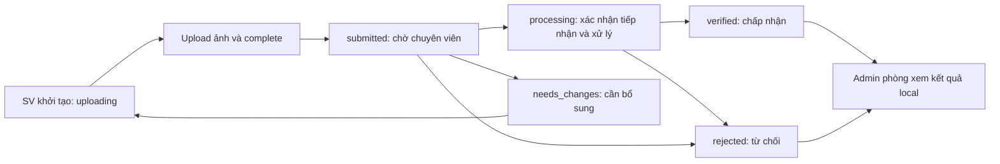
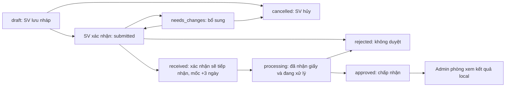

# Luồng chứng chỉ và nghỉ học theo code hiện tại

## Nguồn dữ liệu

| Dữ liệu | Nguồn |
| --- | --- |
| Tài khoản, mật khẩu, vai trò, phòng và tác vụ của chuyên viên/admin | DB local: `auth.LocalAccounts`, `auth.AccountProfiles`, `auth.Fields`, `auth.Tasks`, `auth.AccountTasks`, `auth.TaskPermissions` |
| Hồ sơ và danh mục chứng chỉ ngoại ngữ | DB local: schema `certification`, hồ sơ tại `StudentCertificates`, file metadata tại `EvidenceFiles` |
| Hồ sơ chứng chỉ tin học | DB local: `certification.tmCNTTChungChi_SV`, metadata/lần nộp/snapshot tại `certification.tmCNTTChungChi_File` |
| Đơn nghỉ học, gia hạn, trở lại học và lịch sử | DB local: `academic_leave.Applications`, `academic_leave.ApplicationHistory` |
| Họ tên/lớp/CCCD trên trang chuyên viên/admin | Snapshot đã lưu local; không tra lại DB trường khi xem danh sách, chi tiết hoặc bản ghi tin học nhập trước đây |
| Nội dung ảnh minh chứng | R2; local giữ metadata, kết quả kiểm tra và liên kết object; API cấp URL xem theo quyền |

Sinh viên vẫn xác thực bằng DUT SSO. Khi lập/nộp hồ sơ, backend lấy thông tin từ
SSO/profile và tra CCCD còn thiếu theo MSSV đã xác thực ở DB trường. Khi xác nhận
đơn nghỉ học, backend lấy bảng điểm để lưu snapshot local. Kỳ hiện tại của form
sinh viên lấy từ cấu hình trường. Các bước đó không chạy khi chuyên viên/admin
đọc hồ sơ đã lưu. Thiếu dữ liệu trên hồ sơ cũ được giữ là thiếu, không tự thay
snapshot bằng thông tin hiện tại từ trường.

## Vai trò và quyền

| Vai trò | Công việc |
| --- | --- |
| Sinh viên | Lập/nộp, xem hồ sơ của chính mình; bổ sung hoặc hủy khi trạng thái cho phép |
| Chuyên viên DT, task 1 | Xét duyệt chứng chỉ ngoại ngữ với quyền `certifications:review` |
| Chuyên viên DT, task 2 | Xét duyệt chứng chỉ tin học với quyền `certifications:review` |
| Chuyên viên DT, task 3 | Xét duyệt và nhận giấy đơn nghỉ học với quyền `academic-leave:review` |
| Admin phòng DT | Quản lý chuyên viên/tác vụ cùng phòng; xem tiến độ và GET hồ sơ chứng chỉ/nghỉ học; không xét duyệt hoặc sửa hồ sơ |
| Admin tổng | Quản lý phòng/admin phòng; không trực tiếp xử lý hoặc duyệt hồ sơ sinh viên |

Admin không phải một cấp duyệt tiếp theo sau chuyên viên. Sinh viên gửi hồ sơ,
chuyên viên xử lý, admin phòng theo dõi kết quả từ cùng dữ liệu local. Không có
trạng thái “chờ admin duyệt”. Các kiểm tra audience admin/staff vẫn tách biệt;
FE thử nghiệm của chuyên viên dùng đăng nhập `/api/admin/auth` với tài khoản local
được giao tác vụ, không dùng token SSO sinh viên.

## Chứng chỉ: ngoại ngữ và tin học



| Trạng thái | Ý nghĩa và thao tác |
| --- | --- |
| `uploading` | Chưa nộp hoàn tất; sinh viên tiếp tục upload/complete. Chuyên viên chưa xét duyệt được. |
| `checking` | Trạng thái kỹ thuật lúc kiểm tra ảnh; API trình bày là `uploading` với `processing=true` ở DTO có thông tin này. Không phải bước chuyên viên xử lý. |
| `submitted` | Đã nộp và qua bước kiểm tra ảnh; chuyên viên chọn `processing` để tiếp nhận, hoặc `needs_changes`/`rejected` ở mốc kiểm tra online. |
| `processing` | Đã tiếp nhận, đang xử lý; kết thúc bằng `verified` hoặc `rejected`. Không yêu cầu bổ sung ở giai đoạn này. |
| `needs_changes` | Cần bổ sung, bắt buộc lý do; sinh viên sửa/thay ảnh rồi nộp lại. Tin học giữ các lần nộp trong metadata file. |
| `verified` | Chuyên viên đã xác minh; không sửa/nộp lại hồ sơ đó theo luồng hiện tại. |
| `rejected` | Chuyên viên từ chối, bắt buộc lý do; không bổ sung trên hồ sơ đó. |

Lưu thao tác yêu cầu `If-Match` từ `rowVersion` vừa tải. Khi kết luận `verified`,
`verificationMethod` bắt buộc: `document_comparison`, `issuer_lookup`, `other`;
những thao tác khác có thể bỏ trường này. Từ chối/bổ sung bắt buộc lý do.
Sai phiên bản hoặc sai bước trả `409`; không thể duyệt thẳng từ `submitted`.
Kiểm tra ảnh không tự xác minh chứng chỉ. Boolean `processing=true` cũ trong DTO
vẫn chỉ việc kiểm tra ảnh; trạng thái nghiệp vụ mới là chuỗi `status='processing'`.

Base API sinh viên: `/api/student/certifications`, `/api/student/it-certifications`.
Base API chuyên viên/admin: `/api/admin/certifications`, `/api/admin/it-certifications`.
Các URL `/api/certifications`, `/api/it-certifications` và nhánh `/reviewer` vẫn là
alias tương thích. Mỗi module có endpoint `/events` riêng; chuyên viên task 2
không cần được giao thêm task 1 để nhận cập nhật tin học. Kênh cập nhật chỉ phát
thay đổi thuộc đúng nhóm chứng chỉ của endpoint.

## Nghỉ học, gia hạn và trở lại học



| Trạng thái | Ý nghĩa và thao tác |
| --- | --- |
| `draft` | SV lưu/sửa nháp; được xác nhận hoặc hủy. |
| `submitted` | SV đã xác nhận lập đơn, chốt snapshot thông tin và bảng điểm; được in. Chuyên viên xác nhận sẽ tiếp nhận (`received`), yêu cầu bổ sung hoặc từ chối. |
| `needs_changes` | Chuyên viên yêu cầu bổ sung có lý do; SV sửa và xác nhận lại hoặc hủy. |
| `received` | Đã xác nhận sẽ tiếp nhận online, đang chờ giấy. `receivedAt` ghi thời điểm xác nhận; `paperDeadlineAt` giữ tên API cũ nhưng là mốc +3 ngày. Không được từ chối/bổ sung khi đang chờ giấy. |
| `processing` | Chuyên viên đã nhận bản giấy và bắt đầu xử lý; kết thúc bằng `approved` hoặc `rejected`. |
| `approved` | Chấp nhận cuối cùng sau khi xử lý giấy; không có bước duyệt admin tiếp theo. |
| `rejected` | Từ chối lúc kiểm tra online (`submitted`) hoặc kết thúc xử lý (`processing`), bắt buộc lý do. |
| `cancelled` | SV hủy khi còn `draft` hoặc `needs_changes`. |

Qua mốc +3 ngày mà chưa nộp giấy, đơn vẫn `received`, `overdue=true` chỉ để hiển thị;
không tự từ chối/hủy/đổi trạng thái và không chặn nhận giấy muộn.
Chỉ in ở `submitted`, `received`, `processing`, `approved`; in lại dùng snapshot local.
Mọi thay đổi đơn đã tạo yêu cầu `If-Match`. Lịch sử local ghi thao tác, người xử lý,
thời điểm và dữ liệu đơn tại thời điểm thay đổi.

Ba loại đơn cùng dùng luồng này: `leave` (ngừng học), `extension` (gia hạn),
`return` (trở lại học). Gia hạn/trở lại liên kết đơn ngừng học/gia hạn đã duyệt
của chính SV ở trạng thái cuối `approved`; đơn chỉ mới chờ giấy/đang xử lý chưa
đủ điều kiện. Điều kiện kỳ và đơn kế tiếp được kiểm tra trong nghiệp vụ và
transaction. Gia hạn ở kỳ liền sau; trở lại từ kỳ kết thúc ngừng học trở đi.
Không tự ghi quyết định hay cập nhật trạng thái học tập vào DB trường.

Base API sinh viên: `/api/student/academic-leave`; chuyên viên/admin:
`/api/admin/academic-leave`. Nhận giấy dùng
`POST /applications/:id/receive-paper` đưa `received` sang `processing`, không gửi
`processing` vào `/review` để bỏ qua việc ghi nhận nhận giấy. `/review` nhận
`received`/`needs_changes`/`rejected` khi đang `submitted`, hoặc `approved`/`rejected`
khi đang `processing`. `allowedActions` trong response hướng dẫn FE hiển thị thao tác;
phân quyền vẫn được kiểm tra độc lập ở BE.
URL `/api/academic-leave` và `/api/academic-leave/reviewer` vẫn tương thích.

## Admin theo dõi

Admin phòng dùng `GET /api/admin/organization/progress/:taskId`, với task 1, 2,
3 tương ứng ngoại ngữ, tin học, nghỉ học. Endpoint đọc local, chỉ trả metadata
tiến độ trong phòng; không cấp quyền xét duyệt và không trả secret/URL file.
Trạng thái tin học dựa trên lần nộp hoàn tất gần nhất, nên lần upload bổ sung
đang dở không làm mất trạng thái cần bổ sung của hồ sơ đang theo dõi.

Không dùng `failed`: từ chối cuối quá trình xử lý vẫn là `rejected`. Chuyên viên
chỉ được từ chối ở hai mốc: kiểm tra online và kết thúc xử lý.

## Nâng cấp DB local

Áp dụng migration trước khi khởi động backend mới:

```sh
npm run db:review-workflow:upgrade
```

CLI dùng guard loopback/tên DB hiện có và [migration](../scripts/database/sql/review-workflow.sql)
chạy trong transaction. Với DB chưa có module nghỉ học, `npm run academic-leave:db:init`
chạy cả schema nền và nâng cấp workflow. Không chạy migration trên DB trường.

Migration chuyển nghĩa dữ liệu nghỉ học cũ đúng một lần: `approved` cũ (chờ giấy)
thành `received`; `paper_received` cũ thành `processing`. Giữ mã đơn, snapshot,
các thời điểm cũ, thêm `receivedAt` từ thời điểm xét duyệt online cũ và ghi lịch sử
`workflow_upgraded`. Không tự coi hồ sơ cũ đã được chấp nhận cuối cùng. Kết quả
chứng chỉ `verified`/`rejected` cũ được giữ nguyên. Chạy lại không đổi các đơn
`approved` mới; schema lưu marker `ReviewWorkflowVersion`. Constraint không tương
thích làm rollback, cần đối chiếu metadata thực tế trước khi áp dụng.

## Kiểm chứng

Test offline bao phủ đọc hồ sơ local khi thiếu dữ liệu cũ, không gọi profile/DB
trường; giữ kiểm tra sở hữu; phân quyền và tách sự kiện theo task; quyền admin
phòng chỉ theo dõi; hợp đồng DTO thao tác và trạng thái; hai mốc từ chối; nhận giấy
muộn; cấm bỏ bước; kiểm tra phiên bản; chỉ đơn đã chấp nhận làm đơn gốc. Test SQL
offline kiểm tra batch và guard, chưa chứng minh migration chạy thành công trên
schema thật. Không chạy migration/seed; kết nối đọc metadata local chưa thành công.
