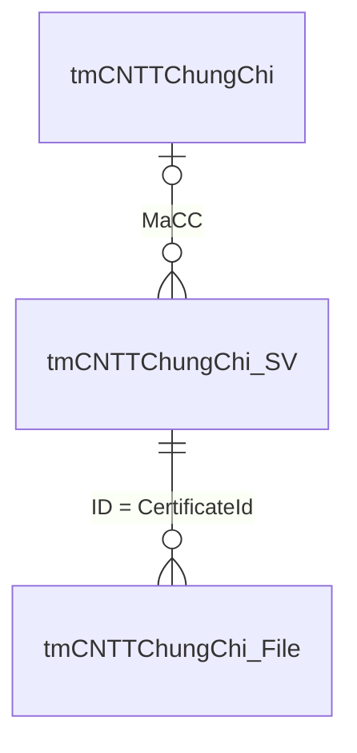

# Certification API — hướng dẫn tích hợp FE

Base URL: `/api/certifications`.
Collection: [certifications.postman_collection.json](data/certifications.postman_collection.json).
Tài liệu này mô tả API chức năng, không bao gồm tài khoản hoặc giao diện thử nghiệm local.

## Xác thực

Sinh viên gửi `Authorization: Bearer <DUT SSO access token>`. Backend xác thực
token bằng API hồ sơ DUT để lấy MSSV, tên, lớp; khóa tuyển sinh suy từ MSSV.
Không có sinh viên mặc định hoặc quyền tự cấp khi request thiếu token.

Các route `/reviewer` và `/management` cần backend nối adapter xác thực thật
qua `contextProvider(req, scope)` hoặc `reviewerAuthentication.actor(req, scope)`
khi gọi `createCertificationsModule`. `scope` là `student`, `reviewer` hoặc `catalog`;
adapter chuyên viên chỉ nhận hai scope sau. Chưa nối adapter thì trả 503 với
`CERT_AUTH_CONTEXT_REQUIRED`; module mặc định không cung cấp tài khoản hoặc route đăng nhập local.
FE cần thống nhất loại token/phiên chuyên viên với adapter được triển khai.

Adapter trả ngữ cảnh tin cậy: `role` (`student` hoặc `reviewer`), `source`,
`reference`, `name`, `permissions`; sinh viên có thêm `studentCode`, `cohortYear`.
Quản lý danh mục cần `permissions` chứa `certifications:catalog:manage`.
Không nhận vai trò, MSSV, khóa hoặc quyền từ dữ liệu do FE tự khai làm căn cứ xác thực.

## Database

Schema `certification` trong SQL Server local `Studentpage` dùng chung cho ngoại ngữ
và tin học. Phần ngoại ngữ có sáu bảng sau; ba bảng tin học được mô tả ở cuối tài liệu.

| Bảng | Lưu gì |
| --- | --- |
| Languages | Mã và tên ngôn ngữ, trạng thái xuất bản |
| CertificateTypes | Loại chứng chỉ, ngôn ngữ, FormSchemaJson, số cấu hình |
| CertificateLevels | Mã/tên bậc, trọng số và ID trường; liên kết loại chứng chỉ |
| RecognitionPolicies | Được nhận hay không theo khoảng khóa, lý do/văn bản |
| StudentCertificates | Một dòng cho mỗi chứng chỉ sinh viên: thông tin, kết quả, trạng thái và đánh giá gần nhất |
| EvidenceFiles | Metadata, ObjectKey trong evidence, trạng thái nhận và InspectionJson |

Không có cột điểm dành riêng cho IELTS/TOEIC. `ResultJson` giữ điểm hoặc mã level
theo cấu hình form. Bổ sung cập nhật cùng dòng StudentCertificates, thay bộ file
hiện tại và xóa đánh giá cũ để chờ nộp/duyệt lại. Không tạo lịch sử phiên bản.
`CreatedAt` giữ ngày tạo, `UpdatedAt` ghi thay đổi gần nhất, `SubmittedAt` và
`ReviewedAt` ghi ngày nộp/duyệt hiện tại. Snapshot chỉ giữ tên/mã, cấu hình form
và các quy định đã dùng; không sao chép toàn bộ danh mục.

Chạy [certifications-compact.sql](sql/certifications-compact.sql) sau khi sao lưu
bốn bảng workflow cũ. Migration giữ ID hồ sơ, lấy thông tin/file mới nhất và
đánh giá tương ứng; nếu có bản bổ sung đang upload thì chuyển bản đó sang uploading.
Các lần nộp cũ chỉ còn trong bản sao lưu. Script dùng transaction, chạy lại được,
giữ nguyên bốn bảng danh mục/level/quy định và bỏ Applications/Submissions/Reviews
cùng cột TemporaryObjectKey. Backend yêu cầu cấu trúc mới, không còn ghi schema v3/v4.
Với DB đã chuyển cấu trúc gọn, chạy tiếp
[certifications-single-evidence.sql](sql/certifications-single-evidence.sql) để giới hạn
một file hiện tại cho mỗi hồ sơ. Script từ chối nếu có hồ sơ nhiều file, không tự xóa dữ liệu.
Catalog đã được nhập
từ DB trường: 13 loại gốc, 40 dòng bậc; đã mở rộng thành 19 loại và 74 bậc.
HSK đủ 1–9; DELF A1–B2/DALF C1–C2; JLPT N5–N1, J-TEST; thêm TCF, HSKK, TOCFL.
NAT/TOPJ giữ trong quản trị, chưa xuất bản cho form sinh viên. Đã áp dụng quy
định thật do người dùng xác nhận: đến K23 nhận các loại đang mở; từ K24 chỉ
chặn TOEIC 2 kỹ năng. Không seed hồ sơ sinh viên.

## Quản lý danh mục và form

Người quản lý có quyền `certifications:catalog:manage`; quyền này tách khỏi
xét duyệt. Ngôn ngữ và loại mới mặc định chưa xuất bản nếu không gửi
`isPublished: true`. `isPublished` phục vụ xuất bản cấu hình, không dùng thay
cho quy định công nhận theo khóa.

Tạo ngôn ngữ:

```json
{ "code": "ru", "displayName": "Tiếng Nga", "isPublished": true }
```

Ví dụ cấu hình IELTS với ID ngôn ngữ thực tế (IELTS đã nhập từ nguồn, không POST tạo lại):

```json
{
  "languageId": 1,
  "code": "IELTS",
  "displayName": "Anh ngữ - IELTS",
  "isPublished": true,
  "formSchema": {
    "fields": [
      { "key": "overall", "label": "Điểm tổng", "type": "number", "required": true, "min": 0, "max": 9, "step": 0.5 }
    ]
  }
}
```

Trường number có min/max/step; trường select có options, ví dụ:

```json
{ "key": "level", "label": "Cấp độ", "type": "select", "required": true, "options": ["B1", "B2"] }
```

TOEIC bốn kỹ năng khai bốn trường listening, reading, speaking, writing.
Chứng chỉ Nga hoặc ngôn ngữ khác có thể khai các trường riêng, không cần đổi
cột DB hoặc mã backend. Tối đa 20 trường; không cho tên trường trùng hoặc
thực thi biểu thức/code tùy ý. Form nhận điểm hợp lệ, không tự xét đạt chuẩn đầu ra.

PATCH quản trị gửi đủ các trường như POST và header `If-Match: "rowVersion"`
từ bản ghi vừa đọc. Không chuyển loại đã được dùng sang một ngôn ngữ khác.
Đổi mã/tên hoặc form tăng revision; snapshot của hồ sơ hiện có giữ nguyên đến khi sinh viên cập nhật hồ sơ.
Riêng `isSchoolProvided=true`, mã/tên loại và mã/tên bậc phải giữ nguyên. Chỉ loại
`isSchoolProvided=false` được đổi mã/tên. Mã trường có thể chứa khoảng trắng và chữ
hoa/thường, ví dụ `Aptis Esol`, `TOEFLiBT`; không chuẩn hóa thành mã khác.
Các mã ngôn ngữ nguồn hiện tại là LN001..LN004, không đổi thành mã ISO tự đặt.

API trả `isSchoolProvided`, `levels`, `baseCertificateTypeId`. Mỗi bậc có
`id/code/displayName/weight`; không trả bản ghi nguồn lồng trong JSON.
Ví dụ lựa chọn `{"value":"VSTEP3","label":"VSTEP B1"}`: FE hiện tên bậc,
result lưu mã bậc. Giá trị NULL/rỗng của trường được giữ trong các cột bảng.
Form chọn bậc lưu `optionsFrom: "certificateLevels"` trong DB; API đọc bảng
bậc để trả `options` cho FE. PATCH có thể gửi lại options nguyên bản hoặc tham
chiếu này; mã/tên bậc của trường không được thay đổi.

## Công nhận theo khóa

Điều kiện thật người dùng xác nhận ngày 25/10/2026 đã được lưu trong DB:

| Khóa tuyển sinh | TOEIC 2 kỹ năng (`TOEIC`) | TOEIC 4 kỹ năng (`TOEIC_FOUR`) và các loại khác đang mở |
| --- | --- | --- |
| K23 trở về trước, gồm K22, K21… | Được nộp | Được nộp |
| K24 trở đi, gồm K25, K26… | Không tiếp nhận | Được nộp |

DB có bốn quy định ngôn ngữ được tiếp nhận không giới hạn khóa và hai khoảng
riêng cho loại TOEIC: đến 2023 được nhận, từ 2024 không được nhận. Phạm vi dưới
bắt đầu 1900 là giới hạn kỹ thuật của mô hình, không phải một mốc tuyển sinh
nghiệp vụ. Năm 2023/2024 là dữ liệu cấu hình, không có if theo khóa trong code.
Không suy hạn chế cho TOEIC_FOUR từ BaseCertificateTypeId.

Quy định được lưu trong RecognitionPolicies và quản lý qua API `/management/policies`.
FE đọc eligibility từ `/catalog`, không tự hardcode mốc khóa hoặc danh sách được nhận.
Khi thay đổi chính sách sau này, cập nhật bản ghi qua API quản trị và đối chiếu
file dữ liệu triển khai trước khi chạy lại SQL áp dụng cấu hình.

Ngày nộp không thay thế khóa tuyển sinh. Sinh viên K23 vẫn nộp TOEIC 2 kỹ năng
được sau năm 2024; sinh viên K24 không được nộp loại này dù chứng chỉ cấp trước đó.

Mỗi quy định chọn **languageId hoặc certificateTypeId**, không chọn cả hai.
Ngôn ngữ phải có khoảng được công nhận; thiếu quy định không mặc định cho phép.
Loại chưa có quy định riêng kế thừa ngôn ngữ; nếu đã khai khoảng riêng thì chỉ
các khoảng được nhận mới hợp lệ. Quy định loại không vượt lệnh cấm của ngôn ngữ.

Thu hẹp khoảng cũ trước khi thêm khoảng mới. DB từ chối các khoảng cùng đối
tượng chồng lấn. Backend kiểm tra khi xin URL và trước khi nhận hồ sơ; dùng
revision và khóa SQL để không ghi nhận một bộ quy định đã thay đổi giữa chừng.
Hồ sơ đã nộp/duyệt vẫn xem được qua bản chụp đã áp dụng.

## Nộp chứng chỉ

Base URL: `/api/certifications`.

1. GET /catalog khi mở form: nhận loại, formSchema, eligibility theo khóa và
   `maxFiles`, `maxFileBytes`, `imageValidation: {maxPixels, minImageSide, blurThreshold}`.
   FE kiểm tra toàn bộ ảnh tại thiết bị: định dạng thực PNG/JPEG, dung lượng,
   giải mã, kích thước, độ tương phản và độ mờ; có ảnh lỗi thì chưa xin URL.
2. POST /applications gửi thông tin + metadata ảnh đã qua kiểm tra, nhận URL PUT cho từng ảnh.
3. PUT bytes từng ảnh trực tiếp vào `certifications/evidence/` trên R2.
4. POST /applications/{applicationId}/complete kiểm tra toàn bộ ảnh và nộp.

Một ảnh có ba request trong thao tác Nộp; GET danh mục là thao tác mở form.
Không có API nháp, tạo phiên bản, complete từng file hoặc submit riêng.

Ví dụ body chuẩn bị:

```json
{
  "data": {
    "fullName": "Nguyễn Văn A",
    "className": "24T1",
    "certificateTypeId": 1,
    "issuedOn": "2026-01-01",
    "result": { "overall": 4.5 }
  },
  "files": [
    { "purpose": "general", "fileName": "certificate.png", "contentType": "image/png", "sizeBytes": 123456 }
  ]
}
```

ID/size là ví dụ, phải lấy ID thật và số byte chính xác. MSSV và cohortYear lấy
từ context server; nếu gửi studentCode thì phải khớp. Không nhận cohortYear từ
body. Không còn trường scores/scoreMode. Chỉ gửi result theo form đã đọc:

- IELTS: `{ "overall": 4.5 }`.
- Loại tự cấu hình cấp độ có thể dùng `{ "level": "B1" }`; VSTEP nguồn trường
  dùng `{ "level": "VSTEP3" }`, hiển thị nhãn nguyên bản `VSTEP B1`.
- TOEIC bốn kỹ năng: `{ "listening": 300, "reading": 300, "speaking": 130, "writing": 140 }`.

Response 201: `{applicationId, expiresAt, uploads: [{id, purpose, fileName, url, method, headers, expiresAt}]}`.
`files` trong request phải có đúng một phần tử; `uploads` trong response cũng chỉ có
một phần tử. Kể cả TOEIC 4 kỹ năng cũng dùng một file minh chứng cho hồ sơ.
PUT đúng file/headers đã khai, bao gồm `Content-Type` và `If-None-Match: *`;
không gửi token backend, multipart hoặc JSON lên R2. Điều kiện được ký cùng URL,
R2 trả 412 khi key đã tồn tại: không thể ghi đè ảnh đã nhận bằng URL còn hạn.
Tham chiếu: [R2 conditional PutObject](https://developers.cloudflare.com/r2/api/s3/extensions/).
Khi PUT lỗi hoặc mất response, FE xin URL mới cho cùng hồ sơ rồi upload lại.
Sau khi tất cả PUT thành công, complete bằng JSON `{}`.

Response complete/get trả một hồ sơ trực tiếp:
`id, studentCode, cohortYear, fullName, className, certificateTypeId, result,
catalogSnapshot, issuedOn, notes, status, processing, rowVersion, expiresAt,
submittedAt, createdAt, updatedAt, files, review`.
`review` là null hoặc `{decision, reason, verificationMethod, reviewerName, reviewedAt}`.
Không còn currentSubmission/pendingSubmission/submissions trong response ngoại ngữ.

Backend đọc và kiểm tra lại ảnh tại ObjectKey, chỉ nhận nếu tất cả file đạt điều kiện,
rồi cập nhật file và StudentCertificates trong một transaction. Mất response có
thể retry complete, không sinh bản trùng. Ảnh lưu R2, DB lưu metadata và kết quả.
Inspection needs_review chưa xác nhận chứng chỉ thật; quyết định do chuyên viên.

Mỗi hồ sơ ngoại ngữ chỉ nhận **một file JPG/JPEG/PNG**, tối đa 10 MiB theo cấu hình.
Đuôi `.jpg` và `.jpeg` cùng dùng MIME `image/jpeg`. API cũng nhận alias `image/jpg`
và chuẩn hóa trước khi ký URL/lưu DB. FE nhận cả đuôi viết hoa; nếu trình duyệt
không cung cấp MIME thì suy từ đuôi. Trước khi xin URL, FE kiểm tra byte nội dung
và gửi MIME thực tế: PNG mang tên `.jpg` vẫn nộp được dưới MIME `image/png`,
giữ nguyên tên và byte ảnh. File không phải PNG/JPEG hoặc không giải mã được vẫn bị từ chối.
Backend tiếp tục đối chiếu nội dung với MIME đã khai báo khi complete.
`GET /catalog` luôn trả `maxFiles: 1`; CERTIFICATIONS_MAX_FILES chỉ còn dùng cho tin học.
Cần bucket R2 private,
cấu hình CORS cho PUT từ FE và cho phép headers `Content-Type`, `If-None-Match`.
Không tạo object temporary trên R2, không copy hoặc dọn file tạm trong luồng mới.
Không đặt lifecycle xóa toàn bộ evidence: prefix này có cả ảnh đã nhận và ảnh đang upload.
Ảnh bị backend xác định không hợp lệ được xóa; lỗi DB/R2 tạm thời giữ ảnh hợp lệ
để retry complete. Ảnh upload bỏ dở hoặc từ URL cũ cần tác vụ đối soát DB/R2
riêng để dọn sau hạn URL; tác vụ này chưa được triển khai.
Kiểm tra FE là bước phản hồi sớm, backend vẫn xác minh nội dung khi complete.
Mặc định blurThreshold=0 chưa tự chặn ảnh mờ khi chưa hiệu chỉnh ngưỡng;
chất lượng đọc được không xác nhận chứng chỉ thật hoặc đủ nội dung.

## Trạng thái và bổ sung

### Cập nhật trực tiếp bằng SSE

Hai nhóm chứng chỉ dùng chung một kênh trên trang:

- Sinh viên: `GET /api/certifications/events`, Bearer token trong Authorization.
- Chuyên viên: `GET /api/certifications/reviewer/events`, xác thực như các API reviewer.

Response có Content-Type `text/event-stream`, event `connected` khi mở kênh và
`certificate.updated` sau khi prepare/complete/xét duyệt ghi DB thành công:

```text
event: certificate.updated
data: {"kind":"it","applicationId":"<uuid>","status":"verified","rowVersion":"<16-hex>"}
```

kind là language hoặc it. Sinh viên chỉ nhận hồ sơ đúng actor reference/source
đã xác thực; chuyên viên nhận thay đổi hai nhóm. Không nhận MSSV/actor/token qua
query string. Payload chỉ là thông báo thay đổi; FE gọi GET chi tiết để lấy dữ liệu.
Không giữ kết nối/transaction DB cho SSE và không truy vấn DB ở heartbeat.

FE thử nghiệm dùng fetch streaming để truyền Bearer header; không đưa token vào URL.
Một trang chỉ mở một kênh, đóng khi ẩn/đăng xuất/rời trang; khi quay lại hoặc kết
nối lại sẽ tải trạng thái mới từ DB. Reconnect có backoff và jitter, không polling
định kỳ. Khi đang nộp hoặc lưu đánh giá, FE gộp cập nhật và tải lại sau thao tác.
Các thông báo đến dồn được gộp trong cửa sổ 150 ms để giảm request tải lại danh sách.

Mặc định một tiến trình cho phép 1000 kết nối, 2 kết nối/actor, heartbeat 25 giây,
đóng sau 5 phút để reconnect và xác thực lại. Đầy kết nối trả 429 + Retry-After.
Client đọc chậm bị đóng kênh để tránh tích lũy bộ đệm. Proxy cần cho phép stream,
tắt buffering; HTTP/2 phù hợp cho triển khai thật. Không có replay log: connected
luôn yêu cầu FE đọc snapshot hiện tại nên không phụ thuộc việc nhận đủ sự kiện.

Broker hiện nằm trong **một tiến trình Node.js**. Khi chạy nhiều instance/worker,
cần thay bằng pub/sub dùng chung để kết quả duyệt ở instance này đến client ở
instance khác; không coi sticky session là thay thế cho việc chia sẻ sự kiện.

### Giới hạn kiểm tra ảnh

Ngoại ngữ và tin học dùng chung một hàng đợi trong tiến trình: mặc định xử lý
2 ảnh đồng thời, tối đa 150 lượt chờ để tiếp nhận đợt nộp dồn khoảng 100–150 người,
chờ tối đa 20 giây. Đây là sức chứa hàng đợi, không phải cam kết hoàn tất 150 ảnh
trong vài giây. Thời gian chờ phụ thuộc HEAD/GET R2 và xử lý ảnh; cần đo với ảnh
thực tế trên máy triển khai để điều chỉnh concurrency/timeout. Slot được cấp **trước
HEAD/GET R2**, nên lượt chờ không giữ buffer ảnh. Giới hạn 2 file trong mỗi request
vẫn được giữ để một hồ sơ nhiều ảnh không chiếm toàn bộ hàng đợi.

Đầy/hết thời gian chờ trả 503 với code CERT_IMAGE_QUEUE_FULL hoặc
CERT_IMAGE_QUEUE_TIMEOUT, kèm Retry-After. Backend nhả claim, giữ file hợp lệ;
có thể thử lại complete trên cùng ID. Không tạo hồ sơ mới để retry. Hàng đợi không
lưu bền hoặc chạy nền; request complete vẫn chờ kết quả. Số lượt xử lý/chờ được
chỉnh bằng CERTIFICATIONS_IMAGE_*; nhiều tiến trình có giới hạn riêng cho từng
tiến trình, không phải giới hạn chung toàn cụm. Tải thực tế cần benchmark riêng.

| Trạng thái | Có sửa/thay ảnh? |
| --- | --- |
| uploading | Có, chưa nộp |
| submitted | Không, chờ duyệt |
| needs_changes | Có, cập nhật chính hồ sơ hiện tại |
| verified | Không |
| rejected | Không |

Bổ sung/xin lại URL dùng POST /applications với applicationId cấp ngoài cùng
và toàn bộ data/files. Khi chuẩn bị bổ sung thành công, hồ sơ chuyển về uploading,
thông tin/file được thay thế, đánh giá cũ được xóa. Complete chuyển sang submitted.
ID và ngày tạo không đổi. Ảnh cũ được dọn sau khi cập nhật DB thành công; lỗi dọn
R2 không làm hỏng việc chuẩn bị hồ sơ. URL ảnh cũ không còn được API cấp.
Chuyên viên chỉ đánh giá, không sửa hộ kết quả sinh viên.

Xét duyệt gửi decision, verificationMethod và If-Match của **application.rowVersion**.
needs_changes và rejected phải có reason. Chỉ trạng thái submitted được duyệt;
hai chuyên viên dùng cùng rowVersion chỉ một người lưu thành công. Bản ghi giữ
đánh giá gần nhất; verified/rejected kết thúc và khóa sửa.

## API hiện tại

| Nhóm | Method | Path |
| --- | --- | --- |
| Sinh viên | GET | /catalog |
| Sinh viên | GET (SSE, chung hai nhóm) | /events |
| Sinh viên | POST | /applications |
| Sinh viên | POST | /applications/{applicationId}/complete |
| Sinh viên | GET | /applications |
| Sinh viên | GET | /applications/{applicationId} |
| Sinh viên | GET | /applications/{applicationId}/files/{fileId}/download |
| Chuyên viên | GET | /reviewer/applications |
| Chuyên viên | GET (SSE, chung hai nhóm) | /reviewer/events |
| Chuyên viên | GET | /reviewer/applications/{applicationId} |
| Chuyên viên | GET | /reviewer/applications/{applicationId}/files/{fileId}/download |
| Chuyên viên | POST | /reviewer/applications/{applicationId}/review |
| Quản trị | GET | /management/catalog |
| Quản trị | POST / PATCH | /management/languages và /management/languages/{id} |
| Quản trị | POST / PATCH | /management/types và /management/types/{id} |
| Quản trị | POST / PATCH | /management/policies và /management/policies/{id} |

Danh sách hỗ trợ page, pageSize, status. Sinh viên chỉ đọc hồ sơ của mình.
Chuyên viên mặc định xem hàng đợi submitted. URL xem ảnh hết hạn sau 120 giây.

Có thêm hai endpoint SSE; collection tập trung các request HTTP hoàn tất và PUT R2/GET ảnh trực tiếp. Nhóm quản trị
chỉ dùng khi thay danh mục/quy định, không phải bước nộp của sinh viên.

## Cấu hình và sử dụng collection

Chỉ import file collection ở đầu tài liệu, theo Postman v2.1 và giữ URL đầy đủ.
Ba thư mục: Quản lý danh mục, Sinh viên, Chuyên viên. Đọc quản lý danh mục trước;
không tạo lại mã trường hoặc các quy định đã nhập. Quy định thật đã áp dụng,
có thể đọc /catalog và thử nộp ngay theo khóa của tài khoản.
Chỉ tạo ngôn ngữ/loại mới khi cần bổ sung ngoài nguồn.

Đặt fileBytes chính xác. Ở PUT chọn Body binary và dùng URL duy nhất trả về.
Khi được yêu cầu bổ sung, gửi lại applicationId cũ, thông tin đã sửa và một file mới.
Các POST từ Apidog tạo dữ liệu thật, không tự rollback.

Điền `studentAccessToken` bằng DUT SSO token. Các biến `reviewerAccessToken` và
`managementAccessToken` chỉ dùng khi adapter triển khai xác thực bằng Bearer;
nếu adapter dùng cookie thì điều chỉnh auth tương ứng và gửi credentials.
Không lưu token thật vào collection hoặc Git.

GET `/catalog` có `student` để FE điền thông tin và `imageValidation` để kiểm tra
ảnh trước khi xin URL. Token sai bị từ chối; token sinh viên không cấp quyền xét duyệt.

Backend cần `LOCAL_DB_NAME=Studentpage` trên SQL Server local, Windows Authentication
và ODBC driver tương ứng. Cấu hình R2 qua `R2_ACCOUNT_ID`, `R2_ACCESS_KEY_ID`,
`R2_SECRET_ACCESS_KEY`, `R2_BUCKET_NAME`; bật `CERTIFICATIONS_R2_PRIVATE_CONFIRMED`
sau khi xác nhận bucket private. Không đưa thông tin bí mật vào FE.

Lỗi chính: 400 body/cấu hình sai; 403 quyền/MSSV không khớp; 409 trạng thái,
token hoặc khoảng khóa xung đột; 410 URL hết hạn; 413 quá giới hạn metadata;
415 gửi sai JSON; 422 kết quả/ảnh/chính sách không hợp lệ; 428 thiếu If-Match;
502 R2 không đọc/xử lý được; 503 DB/storage chưa sẵn sàng.

## Chứng chỉ tin học

Base URL: **`/api/it-certifications`**. Dùng chung xác thực DUT, R2 private và
kiểm tra ảnh với ngoại ngữ. Tin học dùng đúng cấu trúc DB gốc `tmProxDUT`.
FE thử nghiệm local có mục Tin học: sinh viên mở `http://localhost:5173/?kind=it`,
chuyên viên mở `http://localhost:5174/?kind=it`. Chạy bằng `npm.cmd run certifications:fe`;
backend cần chạy cùng bản mới và bật adapter local theo README của FE test.

### DB local và nhập dữ liệu gốc

Chạy [it-certifications.sql](sql/it-certifications.sql) trên **Studentpage**:

| Bảng | Vai trò |
| --- | --- |
| `certification.tmCNTTChungChi` | Danh mục: ID, MaCC, TenCC; PK trên ID và UNIQUE trên MaCC |
| `certification.tmCNTTChungChi_SV` | Giữ đủ 10 cột gốc; PK trên ID, FK MaCC tới danh mục |
| `certification.tmCNTTChungChi_File` | Metadata file và xử lý; FK CertificateId tới chứng chỉ sinh viên |

Đối chiếu trực tiếp metadata nguồn ngày 26/10/2026: giữ nguyên tên, thứ tự cột,
kiểu dữ liệu, độ dài, collation, nullable và identity. Theo yêu cầu quản lý quan hệ,
bản local bổ sung PK, UNIQUE, FK và index, dùng chung schema certification với ngoại ngữ.
`tmCNTTChungChi.ID` là `IDENTITY(1,1)`; `tmCNTTChungChi_SV.ID` là
`int NOT NULL`, **không tự tăng**. API cấp ID mới bằng MAX(ID)+1 trong transaction
khóa bảng. Khi import, giữ ID gốc và thực hiện ngoài thời gian có request ghi.

DB cho phép NULL giống nguồn để nhập dữ liệu cũ. API kê khai mới yêu cầu MaHS,
MaCC và **CoSoCapCC**; không thêm NOT NULL vào bảng gốc. MaHS_SoVaoSo được giữ
nguyên nếu truyền, không tự ghép. Không suy ra ngày sinh, điểm thi hoặc khóa thi.

Script tạo cấu trúc mới hoặc chuyển ba bảng dbo hiện có sang certification bằng
ALTER SCHEMA TRANSFER, giữ dữ liệu và object ID, sau đó tạo các khóa trong cùng
transaction. Chạy lại được; nếu cả dbo và certification cùng có bảng trùng tên
thì script từ chối để tránh nhập nhằng. ID trùng, MaCC danh mục trùng, mã không có
trong danh mục hoặc file mồ côi làm rollback toàn bộ; không tự đổi ID hay xóa dòng.

Nhập **danh mục trước, chứng chỉ sinh viên sau, file cuối cùng**. Catalog dùng
cột ID, MaCC, TenCC và IDENTITY_INSERT nếu giữ ID gốc; chứng chỉ dùng đủ 10 cột
dưới đây. Mã lịch sử phải có dòng danh mục tương ứng trước khi nhập chứng chỉ.
PK không cho trùng ID; FK không cho xóa danh mục/chứng chỉ đang có bản ghi con.
Không tự gán trạng thái được công nhận cho dữ liệu import.



MaCC vẫn nullable như nguồn; dòng có MaCC khác NULL phải tham chiếu danh mục hợp lệ.
CertificateId của file bắt buộc tham chiếu một ID chứng chỉ sinh viên đã tồn tại.

API không còn dùng bốn bảng it_certification.Applications/Submissions/EvidenceFiles/
Reviews. Chạy [script dọn schema cũ](sql/it-certifications-remove-empty-legacy.sql)
nếu cả bốn bảng trống; script từ chối khi có dữ liệu. Schema ngoại ngữ không thay đổi.

### Form và request

`GET /form` trả catalog (ID, MaCC, TenCC đọc từ tmCNTTChungChi), fields, student,
giới hạn file và kiểm tra ảnh. Form chỉ hiển thị đúng năm mục theo thứ tự:
**Số hiệu → Cơ sở cấp chứng chỉ → Số vào sổ → Tên chứng chỉ → Ngày cấp**.
Tên chứng chỉ chọn theo TenCC trong catalog, gửi MaCC tương ứng. Backend tự lấy
MaHS từ tài khoản đăng nhập; FE không cần gửi. Họ tên/lớp chỉ là thông tin hồ sơ.
SoNgayQD, GhiChu và MaHS_SoVaoSo vẫn giữ trong DB gốc để nhập dữ liệu lịch sử,
không hiển thị thành ô nhập trong form này.

| Cột gốc / key trong data | Kiểu SQL | Kê khai mới |
| --- | --- | --- |
| ID | int NOT NULL | API cấp, không gửi lên |
| MaHS | nvarchar(9) NULL | Backend lấy từ MSSV đăng nhập; nếu gửi phải khớp |
| MaCC | nvarchar(10) NULL | Bắt buộc, ô Tên chứng chỉ hiển thị TenCC từ catalog |
| SoHieu | nvarchar(20) NULL | Số hiệu, tùy chọn |
| SoVaoSo | nvarchar(30) NULL | Số vào sổ, tùy chọn |
| SoNgayQD | nvarchar(250) NULL | Giữ cột gốc, không hiển thị trên form |
| GhiChu | nvarchar(250) NULL | Giữ cột gốc, không hiển thị trên form |
| CoSoCapCC | nvarchar(250) NULL | **Bắt buộc nhập cơ sở cấp** |
| NgayCC | date NULL | Ngày cấp YYYY-MM-DD, tùy chọn |
| MaHS_SoVaoSo | nvarchar(100) NULL | Giữ cột gốc, không hiển thị trên form |

Ví dụ `POST /applications`:

```json
{
  "data": {
    "SoHieu": "SH-001",
    "CoSoCapCC": "Trường Đại học Bách khoa",
    "SoVaoSo": "VS-001",
    "MaCC": "CNTT01",
    "NgayCC": "2026-10-01"
  },
  "files": [
    {"purpose": "general", "fileName": "tin-hoc.png", "contentType": "image/png", "sizeBytes": 123456}
  ]
}
```

Số byte trên là ví dụ. purpose có thể bỏ qua; nếu gửi chỉ nhận general.
Các key cũ fullName/className/studentCode/birthDate/theoryScore/practicalScore/
examSession trong data không còn hỗ trợ. FE cần chuyển sang key gốc.

### Upload, xem dữ liệu và xét duyệt

1. FE đọc form/catalog và kiểm tra ảnh theo giới hạn backend.
2. POST /applications trả 201: `{applicationId, expiresAt, uploads}`.
3. PUT từng File lên URL R2 với headers đã ký: Content-Type và If-None-Match: *.
   Không gửi token DUT đến R2.
4. POST /applications/{applicationId}/complete, body {}, sau khi PUT đủ.

Ảnh ở `certifications/evidence/it/`. Mỗi lần kê khai lưu một dòng chứng chỉ gốc;
mỗi ảnh có một dòng metadata file. Chỉnh bản nháp cập nhật dòng chứng chỉ của bản
nháp; bổ sung sau needs_changes tạo dòng chứng chỉ và nhóm file mới để giữ lịch sử.
Chuẩn bị upload không đồng nghĩa đã được duyệt.

| Nhóm | Method | Path từ base URL tin học |
| --- | --- | --- |
| Sinh viên | GET | /form |
| Sinh viên | GET | /records |
| Sinh viên | POST | /applications |
| Sinh viên | POST | /applications/{applicationId}/complete |
| Sinh viên | GET | /applications |
| Sinh viên | GET | /applications/{applicationId} |
| Sinh viên | GET | /applications/{applicationId}/files/{fileId}/download |
| Chuyên viên | GET | /reviewer/records |
| Chuyên viên | GET | /reviewer/applications |
| Chuyên viên | GET | /reviewer/applications/{applicationId} |
| Chuyên viên | GET | /reviewer/applications/{applicationId}/files/{fileId}/download |
| Chuyên viên | POST | /reviewer/applications/{applicationId}/review |

`GET /records?page=1&pageSize=20` đọc trực tiếp bảng chứng chỉ gốc, gồm cả dòng
import chưa có file. Sinh viên chỉ xem MaHS của mình; chuyên viên xem toàn bộ.
Trả page, pageSize, totalRecords, totalPages, items; items giữ đủ 10 key cột gốc
và giá trị NULL. Records không nhận filter status.

Danh sách applications nhận page, pageSize, status; chuyên viên mặc định submitted.
Applications chỉ gồm hồ sơ có upload. Mỗi item có data chứa dòng chứng chỉ gốc,
cùng certificateTypeName lấy từ danh mục, id UUID, studentCode, status, rowVersion và thời điểm. Chi tiết trả
currentSubmission, pendingSubmission, submissions; mỗi submission có **data**
chứa đủ 10 key gốc và certificateTypeName ở cấp submission. Phân biệt data.ID số nguyên với UUID của metadata file.

Trạng thái: uploading → submitted → verified, needs_changes hoặc rejected.
Bổ sung: gửi applicationId, các trường gốc và toàn bộ ảnh. Verified/rejected khóa sửa.
Xét duyệt dùng `If-Match: "<rowVersion>"`, body `{decision, reason, verificationMethod}`;
reason bắt buộc với needs_changes/rejected. verificationMethod nhận
`document_comparison`, `issuer_lookup` hoặc `other`. URL xem ảnh chỉ cấp cho ảnh
đã complete; response không lộ bucket/key. Lỗi DB/R2 ở complete có thể retry và
giữ ảnh hợp lệ. URL hết hạn trả 410; xin URL mới cho cùng applicationId.

Kiểm thử SQL trong schema tạm: đặt `IT_CERT_DB_TEST=1` rồi chạy
`node --test tests/integration/it-certifications.test.js`.
