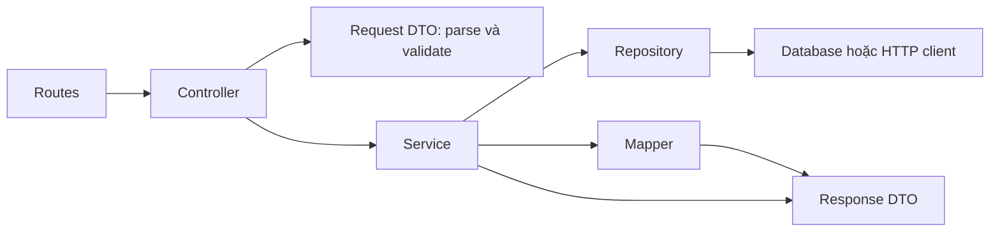

# Quy ước các tầng trong feature

Code được chia theo feature trước, rồi theo trách nhiệm bên trong feature.
`announcements` và `curriculum` là hai mẫu đầy đủ để thêm nghiệp vụ mới.

```text
src/modules/<feature>/
├── index.js                              # Ghép dependency, export API của feature
├── routes/<feature>.routes.js            # URL, HTTP method, middleware
├── controllers/<feature>.controller.js   # Request/response HTTP
├── dto/
│   ├── <feature>.request.dto.js          # Parse, validate, chọn trường đầu vào
│   └── <feature>.response.dto.js         # Contract và factory tạo response
├── services/<feature>.service.js         # Điều phối và quy tắc nghiệp vụ
├── repositories/<feature>.repository.js # Truy cập dữ liệu, bind SQL parameters
├── mappers/<feature>.mapper.js           # Đổi tên trường, chuẩn hóa dữ liệu nguồn
└── __tests__/
```

## Luồng xử lý



Controller nhận DTO đã kiểm tra và gọi service. Repository trả dữ liệu nguồn;
service dùng mapper để tạo dữ liệu theo response DTO, tính toán nghiệp vụ rồi
trả về controller. Controller dùng `sendSuccess` để bọc response HTTP.

## DTO

Project dùng JavaScript ES modules. DTO là object thuần có contract JSDoc để IDE
gợi ý thuộc tính; request DTO có hàm parse/validate chạy thật ở runtime. Response
DTO dùng contract JSDoc và các factory khi cần ghép object trả về.

Ví dụ controller thông báo:

```js
const query = parseAnnouncementsListQuery(req.query);
const data = await service.list(query);
return sendSuccess(res, data);
```

`query` chỉ có `pageIndex` và `pageSize`, được chuyển thành số và kiểm tra giới
hạn. Thiếu tham số thì áp dụng giá trị mặc định; input sai ném `AppError(400)`
trước khi chạm repository. Chi tiết validation của từng API được giữ nguyên.

Các response DTO đang dùng:

- `AnnouncementSummaryDto`, `AnnouncementDetailDto` và page response.
- `AcademicProgramDto`, `CurriculumCourseDto`, `CourseRequirementDto`, counts,
  coverage và `CurriculumResponseDto`.
- `SsoIdentityDto`, `AuthUserDto`, `AuthSessionDto`, me/handoff/logout response.
- `ReadApiRequestDto`, `ReadApiResponseDto` cho adapter upstream. Các API nguồn
  sở hữu field của payload; adapter giữ cấu trúc `data` đang công bố.

JSDoc mô tả kiểu dữ liệu, không tự validate response ở runtime. Mapper chọn rõ
các field công khai khi chuyển dữ liệu SQL hoặc identity sang DTO.

## Mapper

Mapper là hàm thuần: nhận dữ liệu, trả object mới, không sửa dữ liệu đầu vào và
không truy vấn DB hoặc dùng Express.

Ví dụ trong `announcements/mappers/announcements.mapper.js`:

```js
const summary = toAnnouncementSummaryDto(row);
const detail = toAnnouncementDetailDto(row);
```

Mapper đổi `Tieude` thành `title`, decode text lưu trong DB, trim mã và loại các
cột nội bộ. Summary không có nội dung HTML; detail có `contentHtml`. Mapper
curriculum giữ các giá trị `0`, `null` và ánh xạ loại điều kiện học phần.

Mapper auth chỉ nhận claims sau khi service đã xác minh chữ ký, expiry, issuer
và audience. Quyết định quyền, tạo token và thu hồi session nằm trong service.

## Service

Service điều phối nghiệp vụ và nhận repository qua tham số factory:

```js
const service = createAnnouncementsService(repository);
```

Ví dụ nhiệm vụ của service: tính tổng trang, kiểm tra bản ghi có tồn tại, tính
counts/coverage của khung CTĐT, xác minh SSO và quản lý vòng đời phiên. Service
không sử dụng `req`, `res` hoặc gọi controller.

## Repository

Repository thực hiện truy vấn và bind tham số, trả dữ liệu nguồn cho service.
Repository không quyết định HTTP status, không gọi `res.json` hoặc tạo response
envelope. Service xử lý trường hợp không tìm thấy và lỗi nguồn dữ liệu.

Mỗi repository chọn connection cần dùng từ `infrastructure/database/`:

- DB trường: `connectDatabase('primary', databaseName)` hoặc `secondary`.
- DB local: `queryLocalDatabase(statement, parameters)`.

Xem [kết nối hai SQL Server instance](DATABASE_CONNECTIONS.md). Trong file
`repositories/<feature>.repository.js`, đường dẫn import là
`../../../infrastructure/database/index.js`. Những connection này không được
import từ controller, DTO hoặc mapper.

Adapter HTTP cũng có repository (`shared/http/repositories/`): thay placeholder
trong path đã được validate, gọi client và nhận payload. Service gọi mapper để
gỡ envelope. Controller/routes/DTO/mapper của adapter nằm trong cùng `shared/http/`.

## Ghép dependency tại index.js

```js
import { createGradesController } from './controllers/grades.controller.js';
import { createGradesRepository } from './repositories/grades.repository.js';
import { createGradesRouter } from './routes/grades.routes.js';
import { createGradesService } from './services/grades.service.js';

export function createGradesModule({ repository = createGradesRepository() } = {}) {
  const service = createGradesService(repository);
  const controller = createGradesController(service);
  return { basePath: '/api/students/grades', router: createGradesRouter(controller) };
}

export default createGradesModule();
```

Controller chỉ cần service được truyền vào. Test có thể truyền repository giả
vào factory, nên không cần SQL Server hoặc SSH cho test mặc định. Đăng ký feature
trong `src/modules/index.js`; API giữa các feature chỉ export qua `index.js`.

## Feature nhỏ và khung chưa triển khai

`health` hiện có `controllers` và `routes`. `students`, `users`, `admin` có các
khung controller/service/repository/routes theo cấu trúc thống nhất; chưa có
endpoint nghiệp vụ. Thêm DTO/mapper tại đây khi có dữ liệu cần xử lý.

`course-registration` và `timetable` sở hữu allowlist/schema tại
`routes/<feature>.endpoints.js`, dùng bộ lớp chung trong `shared/http/`. Khi
thêm nghiệp vụ riêng, tạo service/mapper trong feature tương ứng.

## Kiểm tra trước khi ghép nhánh

```powershell
npm.cmd run test:feature -- announcements
npm.cmd run check
npm.cmd test
```

Test kiến trúc kiểm tra hướng import giữa các tầng. Test mapper kiểm tra việc
ẩn field nội bộ, giữ `0`/`null`, không sửa bản ghi nguồn và không lấy quyền từ
SSO claims. Các test API hiện có kiểm tra contract và validation xuyên suốt luồng.
