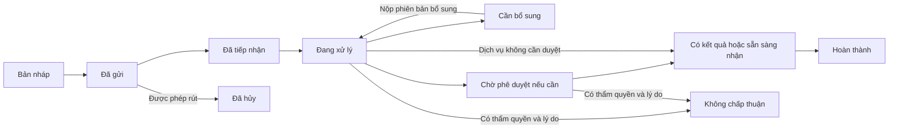
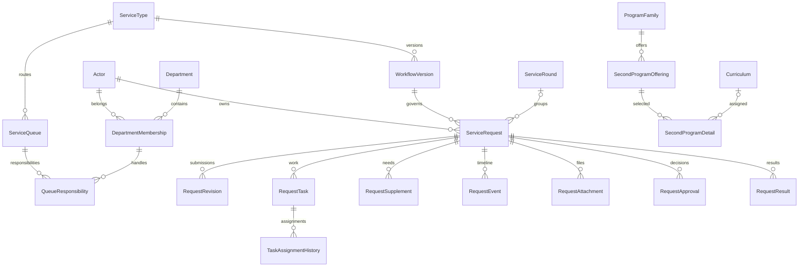

# Kế hoạch đơn đề nghị và theo dõi xử lý sinh viên

> **Quy trình mới nhất:** [Tách xác nhận web và sáu đề nghị đơn giấy](REQUEST_WORKFLOWS.md).
> 11 loại xác nhận xử lý trên web; 6 đề nghị tạo file điền từ DB để SV tải/in và
> xử lý thực tế, chuyên viên chỉ đánh dấu đã xử lý/hủy. “In lại” là tải lại file.
> Đã nhận mẫu Word/PDF và triển khai xuất PDF, snapshot và In lại đúng bản lưu.
> Bộ mẫu trống và cách quản lý: [assets/request-forms](../assets/request-forms/README.md).
> Phần khảo sát bên dưới giữ làm lịch sử; trạng thái triển khai hiện hành ở hai tài liệu trên.

> **Đã có yêu cầu mới và bản thử nghiệm:** xem [REQUESTS_DEMO.md](REQUESTS_DEMO.md).
> Chỉ chuyên viên xử lý; duyệt/ký bên ngoài. Phần role duyệt/ký, trạng thái
> phê duyệt online và schema đầy đủ bên dưới là bản khảo sát cũ, không phải
> mô tả bản demo đang chạy. Demo dùng schema riêng `svc_demo` trong local `sv_dut`.

Ngày khảo sát: **24/10/2026**. Trạng thái: **thiết kế để rà soát, chưa triển khai**.

Đề xuất xây dựng hồ sơ đề nghị mới tại **SQL Server local `sv_dut`**, gồm dữ liệu
biểu mẫu theo từng loại đơn, lịch sử tiến độ, bổ sung thông tin, giao việc và kết
quả. DB trường chỉ cung cấp dữ liệu tham chiếu bằng `SELECT`. Trong lần lập kế
hoạch này **không tạo bảng, không chạy migration và không sửa dữ liệu ở cả local
lẫn DB trường**. Đã kiểm tra `sv_dut` hiện có **0 bảng người dùng**.

Tài liệu nghiệp vụ `NghiepVu_DUT (1).docx` được dùng làm nguồn tham khảo về luồng,
không thay thế yêu cầu của người dùng. Các đoạn ghi “cần xác nhận”, phí, SLA,
thẩm quyền và điều kiện xét vẫn là điểm cần chốt; chưa biến thành quy tắc cứng.
Phạm vi trước mắt là sáu loại đơn trong ảnh, ưu tiên triển khai trọn luồng cấp lại
thẻ trước. Cấp văn bản và hỗ trợ LMS là các dịch vụ mở rộng, không gộp nhầm vào
`His_InDon`.

## 1. Bằng chứng và nguồn dữ liệu

- [Khảo sát bảng đơn và người xử lý](STUDENT_REQUESTS_DATABASE_AUDIT.md).
- [Danh mục, metadata khảo sát trước](data/student-requests-schema-and-catalogs.json).
- [Kết quả kiểm chứng bổ sung cho kế hoạch](data/student-requests-planning-evidence.json).
- Tài liệu Word: mục C, D, G, H và các sơ đồ F07, F11, F15, F16, F21, F25, F26;
  đã đọc nội dung và xem các sơ đồ tương ứng trong file.
- Kiến trúc hiện tại: [ARCHITECTURE.md](ARCHITECTURE.md),
  [LAYERS.md](LAYERS.md), [SSO_SCAFFOLD.md](SSO_SCAFFOLD.md).

Kết quả SQL là ảnh chụp tại thời điểm khảo sát. Chỉ lưu danh mục, metadata và
thống kê tổng hợp; không xuất tên/tài khoản cá nhân, mật khẩu hoặc nội dung đơn.
Không có source ASP.NET của cổng cũ, không đọc được định nghĩa SQL module; vì
vậy không khẳng định đã biết mọi validation và cách trang cũ chọn nguồn DB.

### 1.1 Các bảng đơn và cấu trúc cũ

| Nghiệp vụ | Danh mục | Bản ghi nghiệp vụ | Phân quyền/người xử lý |
| --- | --- | --- | --- |
| Sáu đơn trong ảnh | `DATA_SV1.dbo.LoaiDon` | `DATA_SV1.dbo.His_InDon` | `DATA_GVien1.dbo.SV_QuyenXN`, `tmHosoGV` |
| Cấp giấy, văn bản | `DATA_GVien1.dbo.Sys_VanBan` | `DATA_SV1.dbo.DeNghiVanBan` | `DATA_GVien1.dbo.tmQuyenXNVB`, `tmHosoGV`, `tmDonVi` |
| Email/LMS | `DATA_GVien1.dbo.Sys_Email` | `DATA_SV1.dbo.DeNghiEmail` | `NguoiXuLy` liên kết `tmHosoGV.MaHS`; chưa xác định quyền riêng theo hệ thống |

`His_InDon` hiện có thời điểm lập, nhận, xử lý; mã cán bộ; `Huy`; phản hồi
`NoiDungXL` chỉ dài **50 ký tự**; các ô `DRD01/02`, `CHK01/02`, `LD01/02`.
Chưa có đủ dữ liệu để dựng timeline nhiều lần bổ sung, chuyển người, hủy có lý do
hoặc phân biệt đã duyệt với đã trả kết quả. Không nên chỉ thêm một cột trạng thái
rồi ghi đè các cột cũ.

### 1.2 Chương trình 2 và nhóm ngành

**Nguồn khớp dropdown CT2 là `DATA_GVien1.dbo.tmNganhTQ`.**

| Mục cần lấy | Nguồn/cột | Kết quả kiểm chứng |
| --- | --- | --- |
| Nhóm/chương trình tổng quát | `tmNganhTQ.MaNganhTQ`, `TenNganhTQ`, `CapDT`, `Huy`, `Lock` | Có tên khớp ảnh; 43 dòng `CD01, Huy=0, Lock=0` tại thời điểm đọc |
| Khối ngành | `tmNganhTQ.KhoiNganh`, `KyHieu` | Ví dụ CNTT thuộc khối `V`, ký hiệu `7480201`; đây không phải mã CTĐT theo khóa |
| CTĐT cụ thể theo khóa | `tmNganh.MaNganh`, `TenNganh`, `MaNganhTQ`, `CapDT`, `InUse`, `PubWeb`, `Locked`, `KyBDau`, `KyKthuc` | `MaNganhTQ` có thể thiếu; chỉ 511/1.837 dòng nối được với danh mục tổng quát, 1.298 dòng rỗng |
| Tên ngành quốc gia | `tmNganhQG.MaNganhQG`, `TenNganhQG` | Danh mục khác với nhóm CT2; xem thêm khảo sát CTĐT có sẵn |
| Bảng nhóm ngành khác | `tmProxDUT.dbo.tmNhomNganh` | Có `CapDaoTao`, `KyHieu`, `NhomNganh`, 25 dòng; chưa đủ chứng cứ là nguồn dropdown CT2 |
| CT2 đã gắn cho SV | `tmHoSoSV.MaNganh2`, `HeDT2`, `CapDT2`, `IDCodeN2`, `MaCN2`, `DathoiCT2` | Các cột tồn tại, nhưng `MaNganh2` và `IDCodeN2` đều rỗng trong 54.217 hồ sơ ở `DATA_GVien1`; nguồn `DHBK_CDS` đọc được cũng chưa có dữ liệu hai cột này |

Ví dụ mã tổng quát: `101_CHETAOMAY`, `102_CNTT_DAITRA`, `102_CNTT_CLC-N`.
Trong **210/210** bản ghi `DonSV07`, `DRD01` nối được với
`tmNganhTQ.MaNganhTQ`, `DRD02` nối được với `tmKehoach.IDCode`.

Thiết kế phải lưu riêng **chương trình tổng quát SV chọn** và **CTĐT cụ thể được
phê duyệt**. Không dùng mã `102_CNTT_DAITRA` như `tmNganh.MaNganh`, không tự gán
một CTĐT theo tên gần giống. 43 dòng còn hiệu lực cũng chưa chứng minh cả 43 đang
mở đăng ký CT2; cần danh mục mở theo kỳ/đợt tại local và điều kiện được xác nhận.

### 1.3 Học kỳ và trạng thái sinh viên

| Ý nghĩa | Nguồn đã kiểm tra | Kết luận sử dụng |
| --- | --- | --- |
| Kỳ hiện tại cổng SV | `DATA_SV1.KSoat_Sys.KyHientai` | `2610` |
| Kỳ hiện tại/đăng ký hệ thống ĐK | `DATA_SV1.DKyHoc_KSoat_Sys.KyHienTai`, `KyDangky`, `IDCode_Text` | Cùng `2610`, nhãn “Học kỳ 1/2026-2027” |
| Cấu hình tham số khác | `DATA_SV1.DKOptSys` với `ParaName='KyHienTai'` | Vẫn `2510`, dù `HieuLuc=1`; đang lệch hai nguồn trên |
| Danh mục kỳ và nhãn | `DATA_GVien1.tmKehoach.IDCode`, `TenKH`, `NgayDau`, `Hientai` | Có `2610`, `2620`, `2521`…; nhiều kỳ có `Hientai=1`, không dùng cờ này để chọn duy nhất kỳ hiện tại |
| Bản danh mục khác | `DHBK_CDS.tmKehoach`; `tmProxDUT.tmKehoach` | CDS có kỳ mới; bản proxy đọc được mới tới `2020`, không chọn proxy làm nguồn kỳ hiện tại |
| Kỳ liên quan hồ sơ SV | `tmHoSoSV.IDCodeVao`, `IDCodeTienDo`, `IDCodeRa`, `HanHoc`, `IDCodeMax`; `NhanThan.IDCodeMax` | Là các mục khác nhau. `IDCodeMax` thực tế có `3121`, nên không được hiểu là kỳ đang học |
| Trạng thái/học vụ theo kỳ | `DATA_GVien1.tmHocvu`: `IDCode`, `ngunghoc`, `Thoihoc`, `Dunghoc`, `CB`, `LoaiCB`, `SoQDThoi`, `NgayQDThoi`, `IDCodeHoc`… | Bản đọc được có mã kỳ 3 ký tự và mới nhất trong thống kê là `212`; `iLast=1` có 0 dòng. Chưa đủ để kết luận trạng thái hiện tại năm 2026 |
| Quyết định ngừng/trở lại | `DATA_GVien1.tmNgungTroLaiHoc` | Có kỳ hiệu lực, xác nhận, số/ngày quyết định, người nhận/duyệt từng bước; cần đối chiếu quyết định có hiệu lực |
| Tốt nghiệp/kỷ luật | `DATA_GVien1.tmHoctap`: `KyTN`, `NgayTN`, `SoTN`, các cột quyết định/kỷ luật | Nguồn bổ sung, không suy trạng thái chỉ từ một cờ |
| Cờ hồ sơ và tài khoản | `tmHoSoSV.Tinhtrang1`, `LoaiLuu`; `NhanThan.KhoaTaiKhoan`, `LockDK`, `Hocxong`, `Lock_DeNghiXN`; `DSSV_KhoaWeb` | Chưa có bảng ánh xạ đủ tin cậy cho các cờ; khóa đăng nhập/đăng ký khác với tình trạng học tập |
| `tmTinhTrang` | `DATA_GVien1.tmTinhTrang` | Đã đọc: đây là nội dung thông báo lớp HP/TKB…; không phải danh mục trạng thái học tập SV |

Chính sách dự kiến: lấy kỳ cổng từ `KSoat_Sys`, đối chiếu nguồn ĐK và ánh xạ nhãn
qua `DATA_GVien1.tmKehoach`. Nếu lệch, ghi cảnh báo nguồn và yêu cầu cấu hình nguồn
được duyệt, không tự lấy `MAX(IDCode)` hoặc đổi cấu hình trường. Phải trả kèm
`source`, `observedAt`, `isStale`, `confidence`; khi chưa xác minh trạng thái học
tập, trả `UNKNOWN` thay vì tự gán `ACTIVE`.

Các kỳ trong đơn phải tách rõ: **kỳ hệ thống lúc gửi**, **kỳ mục tiêu của từng
nghiệp vụ**, **kỳ/đợt của dữ liệu học vụ được dùng để xét**. Lưu snapshot lúc gửi
để đổi kỳ hệ thống sau này không làm đổi nghĩa đơn cũ.

`Ma_DotTotNghiep` và `LichXetTotNghiep` có tồn tại, nhưng dữ liệu đọc được lần lượt
ở 2020–2021 và 2019. Chưa dùng làm đợt mở hiện hành; dự kiến cấu hình `ServiceRound`
tại local với nhãn thử nghiệm cho đến khi có nguồn cập nhật được xác nhận.

### 1.4 Tài khoản người xử lý và quyền phòng ban

| Nguồn | Dữ liệu có | Cách dùng trong thiết kế |
| --- | --- | --- |
| `DATA_GVien1.tmHosoGV` | `MaHS`, `TaiKhoan`, `MaBP`, `Nhom`, `WebNhomQ`, `NhomCV`, `IsAdmin`, `KhoaWeb`, `HetHL`; có metadata cột `Account` | Là đầu mối cán bộ. Có 1.667 hồ sơ, 46 dòng có `TaiKhoan`; quyền SELECT cột `Account` bị từ chối, không truy tiếp giá trị cột này |
| `tmDonVi` | `MaDV`, `MaBP`, `TenDV` | 1.667/1.667 cán bộ nối được `tmHosoGV.MaBP = tmDonVi.MaDV`; `tmDonVi.MaBP` là liên kết cấp trên cần giữ riêng |
| `tmNhom` | `MaNhom`, `TenNhom`, các cột quyền desktop/menu | 12 nhóm, ví dụ `DT2` học vụ, `GK` giáo vụ khoa, `SV` CTSV; 722 hồ sơ nối được nhóm |
| `tmNhomWeb` | `MaNhom`, `TenNhom`, `AllKhoa`, các cột quyền web | 22 nhóm: `CT`, `DT`, `GK`, `HT`, `TK`, `TC`, `TT`, `AD`…; 1.382 hồ sơ nối được nhóm web |
| `SV_QuyenXN` | `MaHS`, `MaLoaiDon`, `QuyenNhanDon`, `QuyenXuLy`, `NgayPQ` | Quyền trực tiếp theo loại đơn; phải kiểm tra cờ, không chỉ kiểm tra có dòng |
| `tmQuyenXNVB` | `IDCode`, `MaND`, `MaVBXN` | Quyền cấp văn bản theo kỳ và loại; không áp sang đơn CT2 hoặc LMS |
| `tmSysCVQuyen` | `MaHS`, `MaQuyenCV`, `NgayPQ`, `NguoiPQ` | Quyền công việc khác; cần ánh xạ từng mã, không mặc định là quyền duyệt đơn |
| `DATA_SV1.TKhoanCV` | `TaiKhoan`, `MaHS`, `Khoa`, `Loai`, `ViewAll`, `ChoLuu`, `WSV`, `WDK`, `WFB`… | Có tài khoản chuyên viên của cổng khác nhưng liên kết người xử lý không đầy đủ; không chọn làm nguồn nhân sự duy nhất |

Đơn vị đã đọc: `115` = P. Đào tạo và BĐCL, `120` = P. Công tác sinh viên,
`114` = P. Tổ chức - Hành chính. Đây là tên trong dữ liệu nguồn, không suy diễn
cơ cấu/phạm vi hiện hành chỉ từ tên.

Quyền sáu loại đơn đang có:

| Loại | Nhận và xử lý | Chỉ nhận | Dòng 0/0 |
| --- | ---: | ---: | ---: |
| DonSV01 | 2 | 0 | 20 |
| DonSV03 | 2 | 5 | 15 |
| DonSV04 | 2 | 5 | 15 |
| DonSV05 | 2 | 0 | 20 |
| DonSV06 | 5 | 2 | 15 |
| DonSV07 | 2 | 4 | 16 |

Các actor của đơn đã đối chiếu khớp `tmHosoGV.MaHS`; không nối nhầm với username.
Nhóm `HT`, `AD`, cờ `IsAdmin` hay quyền xử lý cũ **không tự chứng minh quyền ký
quyết định**. `DATA_SV1_Login` chưa truy cập được. Không sao chép mật khẩu cũ hay
giả định đã xác minh cơ chế đăng nhập cán bộ.

## 2. Field của từng biểu mẫu

Đặt tên theo nghiệp vụ; không tạo lại bộ cột chung `DRD/CHK/LD`. Validation chạy ở
backend và frontend; field bị ẩn không được nhận giá trị tùy ý từ client.

| Loại | Field giữ theo ảnh và mapping có bằng chứng | Field nên bổ sung | Điều kiện cần lưu ý |
| --- | --- | --- | --- |
| `DonSV01` cấp lại thẻ, F07 | `reasonCode`: `LOST_OR_DAMAGED` hoặc `CHANGE_INFO`; `changeDescription` cho ô SV điền. `CHK01=LD1` rất có thể là đổi thông tin, `LD01` là nội dung; mapping mã radio cũ còn cần xác nhận | `contactPhone`, `contactEmail` dùng chung; danh sách `requestedChanges` nếu muốn tách field cũ/mới; ảnh/minh chứng và nơi nhận khi có yêu cầu chính thức | `CHANGE_INFO` bắt buộc nội dung đã trim; lựa chọn mất/hỏng không ép nhập thay đổi. Chưa tách mất và hỏng thành hai giá trị nếu chưa thống nhất UI. Đổi nội dung đơn không tự sửa hồ sơ SV |
| `DonSV03` xét CNTN, F21 | `expectedGraduationTermId`, tương ứng `DRD01`; 14.309/14.309 giá trị nối được kỳ | `roundId`, `informationConfirmedAt`; snapshot CTĐT/khóa và kết quả kiểm tra; ý kiến/phản hồi theo đợt nếu mở chức năng này | Kỳ dự kiến khác với kết quả đã tốt nghiệp. Điểm/chứng chỉ lấy từ nguồn được phép hoặc đánh dấu chưa xác minh, không để SV tự nhập thành kết quả chuẩn |
| `DonSV04` hoãn CNTN, F16 | Ảnh hiện không có field nhập thêm | Nên thêm `reason`, `graduationRoundId`, liên kết đăng ký CNTN gốc nếu có, minh chứng khi được yêu cầu | Đây là khoảng thiếu giữa UI cũ và Word. Đề xuất bắt buộc lý do và đợt sau khi chốt nghiệp vụ; chưa coi `LD02` là kỳ/ghi chú đã xác minh. Gửi đơn không tự hoãn tốt nghiệp |
| `DonSV05` học bổng khuyến học | `reviewTermId` ↔ `DRD01`, `reason` ↔ ô lý do/`LD01`; 1.947/1.947 kỳ nối được | `scholarshipCategoryCode`, `roundId`, kết quả dự kiến được phản hồi nếu có, minh chứng | **Chưa được đánh đồng “khuyến học” trong ảnh với “khuyến khích học tập” F25.** Nếu là KKHT, luồng chính là trường xét theo đợt; đơn của SV là phản hồi F26, không tự tạo đơn xin phổ thông. Giữ dịch vụ legacy riêng cho tới khi chốt |
| `DonSV07` CT2, F15 | `selectedProgramFamilyId` ↔ `DRD01` → `tmNganhTQ`; `startTermId` ↔ `DRD02` | `offeringId`, snapshot CTĐT1/khóa/tình trạng học vụ; `assignedCurriculumId` do người có quyền ghi sau khi xét; kết quả kiểm tra điều kiện | Không tự đặt ngưỡng GPA/chỉ tiêu. Nếu chưa map được CTĐT cụ thể, giữ null và tạo task xác minh. Không gán CTĐT2 thật chỉ vì SV gửi/được duyệt trong demo |
| `DonSV06` thôi học, F11 | `withdrawalReasonCode`: `LH001` nguyện vọng cá nhân, `LH002` chuyển trường, lấy từ `tmTieuThuc` | `reasonDetail`, `requestedEffectiveTermId` nếu quy định cần; hồ sơ/đề nghị gốc, xác nhận nghĩa vụ nếu được yêu cầu; số/ngày quyết định và ngày hiệu lực nằm ở kết quả | Phân biệt xin thôi học với buộc thôi học F27. Chuyển trường có thể cần luồng F10 riêng. Không tự hủy các đơn khác do cảnh báo trên ảnh; cần quy tắc được duyệt |

Danh mục lý do thôi học hiện chỉ có `LH001`, `LH002`, nhưng lịch sử có thêm
`LH003…LH010` và một dòng `Lydo`. Khi đọc đơn cũ phải giữ mã chưa ánh xạ với nhãn
“chưa xác định”, không làm rơi bản ghi hoặc nhận các mã này cho đơn mới.

### Field chung nên có cho tất cả đơn

- Mã tra cứu ổn định, chủ hồ sơ, loại dịch vụ, phiên bản form/workflow và kênh
  nộp `ONLINE/COUNTER/LEGACY_IMPORT`; người tạo hộ nếu tiếp nhận trực tiếp.
- Ngày tạo/gửi/tiếp nhận/cập nhật/hoàn thành; phòng chủ trì và hàng đợi. Không
  dùng ngày in thay mọi mốc nghiệp vụ.
- Liên hệ nhận phản hồi; snapshot tối thiểu MSSV/lớp/CTĐT và kỳ hệ thống khi gửi.
  Không sao chép CCCD/thông tin nhạy cảm không cần thiết.
- Trạng thái hồ sơ, bước hiện tại, kết quả; nội dung phản hồi đủ dài; lý do hủy
  hoặc từ chối riêng biệt, actor và thời điểm tương ứng.
- Hạn xử lý/hạn bổ sung nullable, lịch sử thay đổi, file và các bản nội dung đã
  gửi; `rowversion` để tránh hai người ghi đè nhau.
- Nguồn dữ liệu và thời điểm lấy; trạng thái demo/xác minh/cập nhật bên ngoài.
  SV không phải gõ lại thông tin mà backend đã xác định từ danh tính hợp lệ.

Không thêm MAC bắt buộc: trình duyệt không cung cấp MAC máy người dùng. IP chỉ
ghi ở audit theo chính sách, không dùng để xác thực hay phân quyền.

## 3. Tiến độ sinh viên và quy tắc chuyển trạng thái

Trạng thái hồ sơ và trạng thái công việc là hai tập riêng. Mỗi dịch vụ có workflow
phiên bản cố định; không yêu cầu mọi đơn đi qua tất cả bước.

| Trạng thái hồ sơ | Nhãn SV nhìn thấy | Điều kiện/ý nghĩa |
| --- | --- | --- |
| `DRAFT` | Bản nháp | Chỉ chủ hồ sơ xem/sửa; chưa gửi vào hàng đợi |
| `SUBMITTED` | Đã gửi | Server đã nhận bản nội dung hợp lệ; chưa khẳng định người xử lý đã tiếp nhận |
| `RECEIVED` | Đã tiếp nhận | Tiếp nhận được xác nhận; có mốc và actor |
| `IN_PROGRESS` | Đang xử lý | Đang kiểm tra, xác minh, làm thẻ hoặc xử lý công đoạn nghiệp vụ |
| `NEEDS_INFO` | Cần bổ sung | Hiển thị rõ cần bổ sung gì, lý do, hạn nếu có |
| `PENDING_APPROVAL` | Chờ phê duyệt/kết quả | Đủ bước kiểm tra nhưng chưa có quyết định hợp lệ |
| `RESULT_AVAILABLE` | Có kết quả / Sẵn sàng nhận | Kết quả đã phát hành; cần nhận hoặc xác nhận theo dịch vụ |
| `COMPLETED` | Hoàn thành | Đã đáp ứng điều kiện kết thúc, gồm nhận kết quả/cập nhật được xác minh nếu dịch vụ yêu cầu |
| `REJECTED` | Không chấp thuận | Có lý do công khai và người có quyền kết luận; không gọi là hủy |
| `CANCELLED` | Đã hủy/rút | Có actor, lý do, thời điểm; không xóa lịch sử |



Đây là đường chính; bảng chuyển trạng thái của mỗi workflow mới quyết định các
đường bổ sung, quay lại xác minh, hủy và trả kết quả. Không có API cho client tự
`PATCH status` sang giá trị bất kỳ.

Task có trạng thái `QUEUED`, `ASSIGNED`, `IN_PROGRESS`, `WAITING_INFO`,
`WAITING_EXTERNAL`, `DONE`, `SKIPPED`, `CANCELLED`. Một task xong không tự làm
request hoàn thành; chỉ đóng hồ sơ khi tất cả task bắt buộc đã xong/bỏ qua có lý
do, đủ kết quả/duyệt và điều kiện nhận/cập nhật đã thỏa. Các task song song bị
chặn hoặc giải phóng theo dependency; bước hiển thị cho SV do workflow tổng hợp,
không lấy trạng thái của task vừa cập nhật cuối cùng.

Quy tắc xử lý cần thống nhất trong bản đầu:

1. Khi gửi, tạo revision bất biến và mốc `SUBMITTED`; khi nhận, ghi mốc riêng.
   Trước tiếp nhận, hồ sơ ở hàng đợi, chưa cần task nghiệp vụ ngoài bước tiếp nhận.
2. Bổ sung phải có danh sách field/tài liệu còn thiếu. SV chỉ sửa các mục được
   yêu cầu; không đổi loại đơn/chủ hồ sơ. Nộp bổ sung tạo revision mới và mở lại
   bước kiểm tra, không tự duyệt. Vòng bổ sung cũ vẫn xem được.
3. SV tự rút mặc định khi `SUBMITTED`; ở `RECEIVED/IN_PROGRESS` chỉ theo policy
   đã chốt hoặc gửi yêu cầu rút để người có quyền xử lý. Sau quyết định/phát hành
   không cho hủy đơn thuần; phải có quy trình điều chỉnh riêng. Hồ sơ đã hủy vẫn
   xuất hiện trong lịch sử, file in có thông báo mất hiệu lực.
4. Người xử lý kết luận không hợp lệ bằng yêu cầu bổ sung hoặc từ chối theo quyền;
   không dùng `CANCELLED` để che lý do từ chối. Hủy hành chính (trùng, nhập sai)
   là hành động riêng, cần quyền và lý do.
5. Hủy sẽ hủy các task còn mở trong cùng transaction; tác vụ đang chạy phải kiểm
   tra lại `rowversion`/trạng thái trước khi ghi. Không tự hủy các hồ sơ khác.
6. Từ chối, hủy, chuyển người, bỏ qua task đều ghi actor, thời gian và lý do.
   Không tự chuyển trạng thái khi hết hạn nếu chưa chốt chính sách.
7. Bản in gắn request + revision + phiên bản mẫu; in lại không tạo đơn mới. Khi
   nội dung thay đổi hoặc hủy, bản cũ được đánh dấu không còn hiệu lực. QR tra
   cứu chỉ xác minh mã/hiệu lực tối thiểu, không công khai hồ sơ cá nhân.
8. Thời gian lưu UTC `datetime2(3)`, hiển thị Asia/Ho_Chi_Minh. Hạn theo ngày làm
   việc/SLA phải có lịch và quy tắc tạm dừng được duyệt; chưa hard-code mốc trong Word.

Ví dụ timeline cấp lại thẻ: SV gửi “Cần thay đổi thông tin” kèm nội dung → tiếp
nhận → chuyên viên yêu cầu ảnh rõ hơn → SV nộp bổ sung → kiểm tra lại → làm thẻ →
sẵn sàng nhận → đã nhận. Timeline cho biết ngày, bước, phòng phụ trách và phản
hồi công khai; không cần hiển thị phần trăm tiến độ không có căn cứ.

## 4. Các bảng dự kiến tạo mới trong sv_dut

Tên schema dự kiến **`svc`**. Các tên dưới đây là **đặc tả, chưa có bảng hoặc
script migration**. Chỉ tạo theo từng giai đoạn, không tạo hết trước khi cần.

Quy ước: `Id bigint IDENTITY` cho khóa nội bộ; mã public `uniqueidentifier`
không tuần tự và mã tra cứu riêng có unique index; FK chỉ nối bảng trong
`sv_dut`. Mã tham chiếu trường dùng `nvarchar`, giữ số 0 đầu và chuỗi gốc.
Chuỗi Unicode, thời gian UTC; JSON trên SQL Server 2019 dùng `nvarchar(max)` và
`CHECK ISJSON`, không dùng kiểu JSON native. `rowversion` là token đồng thời,
không phải timestamp thời gian. Các bảng master có `IsActive`; hồ sơ/lịch sử
không xóa dây chuyền khi vô hiệu hóa master.

### 4.1 Danh tính và danh mục tham chiếu

| Bảng | Cột chính và khóa | Mục đích |
| --- | --- | --- |
| `Actor` | `Id`, `PublicId UQ`, `Kind STUDENT/STAFF/SYSTEM`, `IdentityProvider nvarchar(40)`, `Subject nvarchar(200)`, `ExternalSource nvarchar(80) NULL`, `ExternalPersonCode nvarchar(30) NULL`, `DisplayName nvarchar(255)`, `IsMock bit`, `IsActive`, thời gian | Danh tính local, UQ `(IdentityProvider, Subject)`; không lưu mật khẩu trường. `MaHS` SV và cán bộ là hai namespace riêng |
| `Department` | `Id`, `ExternalSource`, `ExternalCode nvarchar(20)`, `Name nvarchar(255)`, `ParentDepartmentId FK NULL`, `IsActive`, `ObservedAt` | Cache danh mục phòng/khoa; UQ nguồn + mã; giữ tổ chức local thử nghiệm tách nguồn trường |
| `DepartmentMembership` | `Id`, `ActorId FK`, `DepartmentId FK`, `RoleCode varchar(30)`, `ValidFrom`, `ValidTo NULL`, `IsActive`, `rowversion` | Một cán bộ có thể thuộc nhiều phòng/vai trò; `RoleCode` chỉ là phân vai demo, chưa phải hệ thống RBAC đầy đủ |
| `AcademicTerm` | `Id`, `Source`, `ExternalCode nvarchar(12)`, `Name nvarchar(150)`, `StartDate date NULL`, `EndDate date NULL`, `SortOrder int`, `IsSelectable`, `ObservedAt` | UQ nguồn + mã; giữ mã kỳ 3 và 4 ký tự khác nhau, không tự normalize chúng thành cùng một kỳ |
| `ReferenceSetting` | `Id`, `Scope varchar(40)`, `Key varchar(80)`, `ValueJson`, `Source`, `ObservedAt`, `IsVerified`, `rowversion` | Snapshot kỳ cổng, kỳ ĐK, cảnh báo chênh nguồn; không cập nhật tham số gốc ở trường. UQ scope + key |
| `ProgramFamily` | `Id`, `Source`, `ExternalCode nvarchar(50)`, `Name nvarchar(500)`, `EducationLevelCode nvarchar(10)`, `NationalMajorCode nvarchar(30) NULL`, `MajorBlockCode nvarchar(10) NULL`, `SourceCancelled bit NULL`, `SourceLocked bit NULL`, `ObservedAt` | Cache `tmNganhTQ`; không mất phân biệt giữa `KhoiNganh`, mã ngành quốc gia và chương trình tổng quát |
| `Curriculum` | `Id`, `Source`, `ExternalCode nvarchar(30)`, `Name nvarchar(500)`, `ProgramFamilyId FK NULL`, `FacultyId FK NULL`, `SourceInUse/SourcePublished/SourceLocked bit NULL`, `StartTermId/EndTermId FK NULL`, `MappingVerified bit`, `ObservedAt` | Cache CTĐT cụ thể. UQ nguồn + mã; mapping thiếu để null, không tự ghép theo tên |
| `ServiceOption` | `Id`, `ServiceTypeId FK`, `GroupCode varchar(40)`, `Code nvarchar(50)`, `Label nvarchar(500)`, `IsActive`, `Source`, `ObservedAt` | Lý do thôi học/giá trị chọn; UQ dịch vụ + nhóm + mã. Mã lịch sử mất danh mục chỉ dùng hiển thị, không tự mở cho đơn mới |
| `ServiceRound` | `Id`, `Code UQ`, `ServiceTypeId FK`, `TermId FK NULL`, `Name`, `OpenAt/CloseAt/FeedbackCloseAt NULL`, `Status`, `EligibilityRulesJson`, `IsMock`, `SourceRef NULL`, `rowversion` | Đợt xét CNTN, hoãn CNTN, học bổng nếu áp dụng; thông tin cũ không tự tạo thành đợt đang mở |
| `SecondProgramOffering` | `Id`, `ProgramFamilyId FK`, `StartTermId FK`, `RoundId FK NULL`, `CurriculumId FK NULL`, `ResponsibleDepartmentId FK`, `OpenAt/CloseAt NULL`, `IsOpen`, `EligibilityRulesJson`, `rowversion` | Cấu hình chương trình được mở CT2. Khi kỳ/khóa chưa quyết định CTĐT thì `CurriculumId` null; mở đăng ký khác với cờ hoạt động ở nguồn |

Không lập bảng copy toàn bộ `NhanThan` hoặc `tmHoSoSV`. Context cần xét được
đọc theo chủ hồ sơ, lưu snapshot tối thiểu vào revision kèm nguồn/thời điểm và
trạng thái xác minh. Khóa tài khoản/đăng ký không nhập chung với status hồ sơ.

### 4.2 Danh mục dịch vụ và phân việc

| Bảng | Cột chính và khóa | Quy tắc |
| --- | --- | --- |
| `ServiceType` | `Id`, `Code varchar(50) UQ`, `LegacyCode nvarchar(20) NULL`, `Name nvarchar(255)`, `Category`, `OwnerDepartmentId FK`, `IsEnabled`, `SubmissionChannel`, `DefaultWorkflowVersionId FK NULL`, `rowversion` | Giữ mã legacy nhưng tên dịch vụ mới rõ nghĩa; `IsEnabled` do local cấu hình |
| `WorkflowVersion` | `Id`, `ServiceTypeId FK`, `Version int`, `FormSchemaJson`, `DefinitionJson`, `Status DRAFT/PUBLISHED/RETIRED`, `PublishedAt NULL`, `CreatedByActorId FK` | UQ dịch vụ + version; JSON mô tả field, bước, dependency, transition, quyền, điều kiện kết thúc. Bản published bất biến; request giữ FK phiên bản đã dùng |
| `ServiceQueue` | `Id`, `Code UQ`, `DepartmentId FK`, `ServiceTypeId FK`, `StepCode varchar(60)`, `Name`, `IsActive` | Hàng đợi theo nhóm dịch vụ/công đoạn; không phụ thuộc một cán bộ duy nhất |
| `QueueResponsibility` | `Id`, `QueueId FK`, `MembershipId FK`, `RoundId FK NULL`, `ValidFrom/ValidTo NULL`, `Priority int`, `IsActive`, `rowversion` | Admin phòng cấu hình phụ trách nhóm/đợt; hệ thống điều phối từng task. Chỉ nhận membership đúng phòng/ủy quyền hợp lệ |

MVP dùng workflow và schema form do nhóm phát triển định nghĩa có phiên bản;
chưa xây workflow editor hay bộ máy luật tùy ý. Quy tắc JSON không được chứa SQL
hoặc JavaScript để thực thi từ dữ liệu cấu hình.

### 4.3 Hồ sơ và dữ liệu từng lần gửi

| Bảng | Cột chính và khóa | Quy tắc |
| --- | --- | --- |
| `ServiceRequest` | `Id`, `PublicId UQ`, `TrackingCode nvarchar(40) UQ`, `StudentActorId FK`, `StudentSource`, `ExternalStudentCode nvarchar(30)`, `ServiceTypeId FK`, `WorkflowVersionId FK`, `RoundId FK NULL`, `OwnerDepartmentId FK`, `QueueId FK`, `Status varchar(30)`, `CurrentStepCode NULL`, `CurrentRevisionId FK NULL`, `SubmittedTermId FK NULL`, `SubmissionChannel`, `CreatedByActorId FK`, `ContactEmail/ContactPhone NULL`, `CreatedAt`, `SubmittedAt/ReceivedAt/CompletedAt/DueAt NULL`, `IsSimulation bit`, `CancelReason/RejectReason nvarchar(2000) NULL`, `CancelledByActorId/RejectedByActorId FK NULL`, `CancelledAt/RejectedAt NULL`, `LegacySource/LegacyId NULL`, `rowversion` | Bảng đầu hồ sơ; phản hồi nhiều lần nằm ở event. Kỳ mục tiêu nằm ở chi tiết từng loại. Tạo revision rồi gán current trong cùng transaction để giải quyết FK vòng |
| `RequestRevision` | `Id`, `RequestId FK`, `RevisionNo int`, `Kind SUBMISSION/SUPPLEMENT`, `PayloadJson`, `StudentContextJson`, `FormVersion int`, `ContextObservedAt`, `SubmittedByActorId FK`, `SubmittedAt`, `PayloadHash varbinary(32)`, `SupplementId FK NULL` | UQ request + revision; bất biến sau gửi. Bản nháp ở chi tiết, chỉ tạo revision khi submit. Context có nguồn, trạng thái chưa xác minh, mã kỳ/CTĐT và manifest file cần dùng |
| `CardReplacementDetail` | `RequestId PK/FK`, `ReasonCode varchar(30)`, `ChangeDescription nvarchar(2000) NULL`, `RequestedChangesJson NULL`, `PickupLocation nvarchar(500) NULL` | `CHANGE_INFO` bắt buộc mô tả. JSON thay đổi có field được phép, old/new; chỉ thêm khi nhóm thống nhất form chi tiết |
| `GraduationReviewDetail` | `RequestId PK/FK`, `ExpectedGraduationTermId FK`, `InformationConfirmedAt NULL`, `Statement nvarchar(2000) NULL` | Đợt ở request. Không lưu cờ đã tốt nghiệp dựa trên việc nộp đơn |
| `GraduationDeferralDetail` | `RequestId PK/FK`, `GraduationRoundId FK`, `OriginalGraduationRequestId FK NULL`, `Reason nvarchar(2000)`, `RequestedUntilTermId FK NULL` | FK đơn gốc phải cùng SV/đúng loại; kỳ muốn hoãn đến là đề xuất tùy nghiệp vụ, chưa ép nhập |
| `ScholarshipRequestDetail` | `RequestId PK/FK`, `CategoryCode`, `ReviewTermId FK`, `Reason nvarchar(2000)`, `RelatedPublishedResultRef nvarchar(100) NULL` | Category tách khuyến học legacy và phản hồi KKHT. Kết quả dự kiến và quyền xem phải kiểm tra cùng SV, cùng đợt |
| `SecondProgramDetail` | `RequestId PK/FK`, `OfferingId FK`, `SelectedProgramFamilyId FK`, `StartTermId FK`, `AssignedCurriculumId FK NULL`, `StudyStatement nvarchar(2000) NULL` | Family/kỳ phải khớp offering; assigned curriculum do người có quyền xác minh, ghi revision/kết quả xử lý tương ứng, SV không tự gán |
| `WithdrawalDetail` | `RequestId PK/FK`, `ReasonCode nvarchar(30)`, `ReasonDetail nvarchar(2000) NULL`, `RequestedEffectiveTermId FK NULL`, `DestinationSchool nvarchar(500) NULL`, `ParentSubmission bit NULL` | Code thuộc ServiceOption cho đơn mới. Trường nơi chuyển/phụ huynh là có điều kiện, chỉ đưa vào form khi đã chốt yêu cầu |

Mỗi request chỉ có **một** detail đúng loại; create/update qua service trong
transaction và kiểm tra invariant. SQL FK riêng lẻ không đảm bảo được điều này;
cần kiểm tra ở service và integration test. Không cho đổi `ServiceTypeId` khi đã
gửi. Chi tiết là bản đang dùng; revision giữ bản đã gửi trước đó. Lúc lưu bổ sung,
cập nhật detail + revision + current pointer + timeline trong một transaction.

`AssignedCurriculumId` là dữ liệu xử lý, không cho client SV ghi trong payload;
được phản ánh trong kết quả và event để truy vết. PayloadHash chỉ kiểm tra nội
dung, không thay thế chữ ký số hoặc chứng minh thẩm quyền.

### 4.4 Task, bổ sung, kết quả và lịch sử

| Bảng | Cột chính và khóa | Quy tắc |
| --- | --- | --- |
| `RequestTask` | `Id`, `RequestId FK`, `WorkflowStepCode`, `Iteration int`, `QueueId FK`, `DepartmentId FK`, `AssignedMembershipId FK NULL`, `Status`, `IsRequired bit`, `Priority`, `CreatedAt/AssignedAt/StartedAt/CompletedAt/DueAt NULL`, `BlockedReason NULL`, `OutcomeJson NULL`, `rowversion` | UQ request + step + iteration; một hồ sơ có nhiều task; actor được giao phải còn quyền/phạm vi khi thực hiện |
| `TaskDependency` | `TaskId FK`, `PrerequisiteTaskId FK`, `RequiredOutcome NULL`, PK hai ID | Chỉ task cùng request, không tự phụ thuộc/có chu trình; chỉ thêm khi có song song/phối hợp |
| `TaskAssignmentHistory` | `Id`, `TaskId FK`, `FromMembershipId FK NULL`, `ToMembershipId FK NULL`, `FromQueueId/ToQueueId FK`, `ChangedByActorId FK`, `ChangedAt`, `Reason nvarchar(2000)` | Append-only, kể cả tự điều phối và chuyển phòng; không xóa người xử lý cũ |
| `RequestSupplement` | `Id`, `RequestId FK`, `TaskId FK`, `SequenceNo`, `RequiredItemsJson`, `PublicReason nvarchar(2000)`, `RequestedByActorId FK`, `RequestedAt`, `DueAt NULL`, `Status OPEN/RESPONDED/CLOSED/CANCELLED`, `RespondedAt/ClosedAt NULL`, `ResumeStepCode` | MVP tối đa một yêu cầu bổ sung đang mở/hồ sơ; các task phối hợp tổng hợp yêu cầu trước khi gửi. Revision bổ sung trỏ bản ghi này; thiếu tiếp thì tạo vòng mới |
| `RequestAttachment` | `Id`, `RequestId FK`, `SupplementId FK NULL`, `UploadedByActorId FK`, `Category`, `StorageKey nvarchar(500) UQ`, `OriginalName nvarchar(255)`, `MimeType`, `SizeBytes bigint`, `Sha256 varbinary(32)`, `Visibility`, `UploadedAt`, `ScanStatus`, `SupersedesAttachmentId FK NULL` | Tệp riêng tư; revision tham chiếu danh sách ID bất biến. Kiểm tra file/revision cùng request, file sạch và quyền tải trước khi gửi; thay file không xóa file của revision cũ |
| `RequestEvent` | `Id`, `RequestId FK`, `SequenceNo`, `TaskId FK NULL`, `EventType`, `FromStatus/ToStatus NULL`, `FromStep/ToStep NULL`, `ActorId FK`, `ActorDepartmentId FK NULL`, `ActorLabelSnapshot`, `OccurredAt`, `Visibility STUDENT/INTERNAL`, `PublicMessage nvarchar(2000) NULL`, `InternalMessage nvarchar(max) NULL`, `MetadataJson NULL` | UQ request + sequence; append-only. DTO SV dùng allowlist; không trả internal message/metadata bằng cách serialize cả row |
| `RequestApproval` | `Id`, `RequestId FK`, `TaskId FK`, `RevisionId FK`, `ApprovalStage`, `Decision APPROVED/REJECTED/RETURNED`, `DecidedByMembershipId FK`, `AuthorityRef nvarchar(255)`, `Reason nvarchar(2000) NULL`, `DecisionAt`, `EvidenceAttachmentId FK NULL`, `IsSimulation` | Gắn phiên bản nội dung được xét. Demo phê duyệt phải ghi rõ giả lập; không coi đây là chữ ký số hay quyền ký thật |
| `RequestResult` | `Id`, `RequestId FK`, `ResultType`, `Version int`, `ApprovalId FK NULL`, `DocumentAttachmentId FK NULL`, `DecisionNumber nvarchar(100) NULL`, `DecisionDate/EffectiveDate date NULL`, `PublicSummary nvarchar(2000)`, `IssuedByActorId FK`, `IssuedAt`, `AvailableAt NULL`, `ReceivedAt NULL`, `ReceivedByActorId FK NULL`, `ExternalUpdateStatus`, `ExternalVerificationRef NULL`, `IsSimulation`, `SupersedesResultId FK NULL` | UQ request + version; kết quả quyết định/cấp thẻ/nhận giấy khác nhau. Phiên bản cũ không bị ghi đè |
| `RequestPrintArtifact` | `Id`, `RequestId FK`, `RevisionId FK`, `TemplateVersion`, `AttachmentId FK`, `VerificationCode UQ`, `GeneratedAt`, `InvalidatedAt NULL`, `InvalidationReason NULL` | In lại tải đúng revision; không khẳng định bản in cũ còn hiệu lực sau bổ sung/hủy |
| `NotificationOutbox` | `Id`, `EventId FK`, `RecipientActorId FK`, `Channel WEB/EMAIL`, `DeduplicationKey UQ`, `PayloadJson`, `State`, `Attempts`, `NextAttemptAt NULL`, `SentAt NULL`, `ReadAt NULL`, `LastErrorCode NULL` | Ghi cùng transaction với event; web notification ở MVP. Email worker triển khai sau, retry không tạo thông báo trùng; payload không chứa mật khẩu |
| `AuditLog` | `Id`, `ActorId FK NULL`, `Action`, `EntityType`, `EntityId`, `RequestId FK NULL`, `CorrelationId`, `OccurredAt`, `Reason NULL`, `RedactedMetadataJson`, `IpAddress NULL`, `IsSimulation` | Nhật ký truy cập/thay đổi nhạy cảm và từ chối quyền; không ghi bearer token, mật khẩu hay toàn bộ file/nội dung hồ sơ |
| `CommandReceipt` | `Id`, `ActorId FK`, `Operation varchar(80)`, `IdempotencyKey nvarchar(100)`, `PayloadHash varbinary(32)`, `RequestId FK NULL`, `ResponseCode int`, `ResponseJson`, `CreatedAt` | UQ actor + operation + key; lưu kết quả lệnh trong transaction. Cùng key khác hash trả 409, cùng key cùng nội dung trả kết quả đã ghi; không lưu token hoặc nội dung nhạy cảm dư thừa |

`Visibility` không phải quyền truy cập độc lập: vẫn phải kiểm tra chủ hồ sơ,
task/phòng và loại tệp. Event công khai có thể kèm ghi chú nội bộ nhưng serializer
phải loại phần nội bộ và chỉ lấy metadata đã cho phép. Tài liệu kết quả, file
đính kèm quyết định và bản in phải liên kết đúng request; các FK không đủ tự
kiểm tra quan hệ đó, service phải xác thực trong transaction.

### 4.5 Ràng buộc và index quan trọng

- Index danh sách SV: `(StudentActorId, CreatedAt DESC)` include trạng thái,
  loại dịch vụ, mã tra cứu. Index inbox `(QueueId, Status, DueAt)` và
  `(AssignedMembershipId, Status, DueAt)`; index phòng trên request/task.
- UQ event `(RequestId, SequenceNo)` và revision `(RequestId, RevisionNo)`;
  sinh số dưới khóa/transaction, không `MAX+1` ngoài transaction.
- UQ filtered `RequestSupplement(RequestId)` khi `Status='OPEN'` để giữ tối đa
  một vòng đang yêu cầu SV bổ sung; service kiểm tra thêm task và revision liên quan.
- UQ filtered nguồn import `(LegacySource, LegacyId)` khi có giá trị;
  mã nguyên gốc và nguồn được giữ để không trùng ID giữa ba bảng legacy.
- Index lịch sử theo `(RequestId, OccurredAt, Id)`, file theo request và
  outbox `(State, NextAttemptAt)`; phân trang ổn định có khóa phụ ID.
- Token chống ghi đè: kiểm tra `rowversion` cho request/task/phân công; version
  không khớp trả `409`. Claim task phải cập nhật có điều kiện để chỉ một người nhận.
- Chống gửi lặp bằng idempotency key theo actor + hành động + payload hash,
  lưu `CommandReceipt` cùng giao dịch của lệnh, ngay từ API gửi đơn đầu tiên.
  Không dựa vào frontend hoặc cache trong RAM; không xóa receipt khi còn cho
  phép client retry theo thời hạn công bố.
- CHECK thời gian hợp lệ, tập status/code, độ dài, file size dương, JSON hợp lệ;
  FK không cascade delete hồ sơ/audit. Unique “đơn còn mở theo kỳ/đợt” chỉ thêm
  khi quy tắc từng dịch vụ được chốt, tránh chặn các yêu cầu hợp lệ khác nhau.

### 4.6 Quan hệ tổng quát



Sơ đồ rút gọn, không thay toàn bộ FK trong các bảng trên. Không có FK xuyên
instance tới DB trường và không có distributed transaction local–SSH.

## 5. Giả phân quyền trước khi có RBAC

Hiện auth repository trả `localUserId=null`, `roles=[]`, `permissions=[]`,
`authorizationStatus='pending'`; `requirePermissions` có kiểm tra deny nhưng chưa
gắn đầy đủ quyền nghiệp vụ. Không coi đăng nhập SSO thành công là đã được phép
xử lý đơn.

Đề xuất interface `AuthorizationContextResolver` + policy theo hành động/phạm
vi/quan hệ hồ sơ. Bản đầu dùng danh sách actor, membership, capability **do server
cấu hình/seed tại local**; sau này thay resolver bằng RBAC thật, giữ nguyên kiểm
tra ownership và task scope. Chưa xây các bảng Role/Permission/RolePermission.

| Vai trò giả lập | Được làm | Giới hạn |
| --- | --- | --- |
| `STUDENT` | Tạo, xem, gửi, bổ sung, rút đơn đúng policy, tải file/kết quả của mình | Không chọn chủ hồ sơ khác, phòng xử lý hay trạng thái; không xem SV khác |
| `STAFF` | Tiếp nhận/claim task trong nhóm được giao, kiểm tra, yêu cầu bổ sung, cập nhật công đoạn, trình xét, phản hồi | Không xử lý ngoài phòng/nhóm/task; kết luận duyệt/ký cần capability riêng |
| `DEPARTMENT_ADMIN` | Cấu hình phụ trách hàng đợi/đợt, điều chỉnh phân công và xem tiến độ trong phòng | Không mặc định kiểm tra, yêu cầu bổ sung, từ chối hoặc duyệt hồ sơ; không mặc định xem tất cả tệp cá nhân |
| `SYSTEM_ADMIN` | Cấu hình phòng, admin phòng, dịch vụ và workflow demo, xem audit theo phạm vi | Không tự có quyền ký hoặc thay đổi kết luận chuyên môn |

Capability ví dụ: `request.read.own`, `task.receive`, `task.work`,
`request.supplement.request`, `request.recommend`, `request.decide`,
`result.issue`, `result.deliver`, `queue.assign`, `audit.read`.
`request.decide` cấp riêng theo dịch vụ/phòng và task có thẩm quyền; trong demo
dùng actor giả lập người có thẩm quyền, kết quả gắn `IsSimulation=1`. Một người có
hai vai trò phải chọn context đúng và được cấp hành động rõ ràng, không cộng quyền
admin thành quyền duyệt ngầm.

Cơ chế chạy thử dự kiến:

1. Fixture SV A/B, chuyên viên CTSV A/B, chuyên viên Đào tạo, admin hai phòng và
   người có thẩm quyền demo; không dùng tên/username thật làm fixture công khai.
2. `AUTHORIZATION_MODE=mock` chỉ cho development/test; production từ chối khởi
   động với mode này. Danh tính thử do session/token dev được server phát và xác
   minh, TTL ngắn; không cho request header/body tự gán `role`, `MaHS` hay permission.
3. Nếu dùng SSO thật khi phát triển, ánh xạ provider + subject đã xác minh qua
   allowlist server đến Actor; không suy MSSV từ email không được kiểm chứng.
   Bản demo độc lập có thể dùng token dev riêng, không giả chữ ký SSO trường.
4. Mỗi thao tác kiểm tra đủ: quyền hành động + phòng/dịch vụ + quan hệ chủ
   hồ sơ/task/hàng đợi. Người khác phòng chỉ thấy phần cần thiết khi có task phối
   hợp rõ ràng. Đổi URL hoặc đoán mã public không vượt kiểm tra này.
5. Schema và DTO không cho SV ghi assigned staff, approval, outcome, current
   status; policy không nằm riêng ở nút ẩn/hiện frontend. Mọi thao tác ghi audit.

## 6. Luồng theo dịch vụ và cách kết thúc

| Dịch vụ | Công việc dự kiến | Đầu ra/điểm kết thúc |
| --- | --- | --- |
| Cấp lại thẻ | Nhận → kiểm tra thông tin/lý do → bổ sung nếu thiếu → xác nhận → làm thẻ/phối hợp đơn vị cấp → thông báo → giao nhận | Không đóng ngay ở bước xác nhận; hoàn thành khi đã giao/nhận theo quy định. Đơn vị in và phí chưa chốt |
| CNTN | Nhận đăng ký theo đợt → Đào tạo/Khoa xét → công bố dự kiến/phản hồi → xét lại → Hội đồng/cấp thẩm quyền → ghi nhận quyết định | Đơn đăng ký xong không đồng nghĩa đã tốt nghiệp. Không tự tính điều kiện chính thức khi dữ liệu thiếu/cũ |
| Hoãn CNTN | Kiểm tra đợt/hạn/lý do → trình xét → ghi nhận quyết định → thông báo kết quả | Chỉ thay đổi kết quả hoãn sau quyết định hợp lệ; nhánh bổ sung quay lại kiểm tra |
| Học bổng | Legacy khuyến học: xử lý theo loại đã chốt. Nếu KKHT: mở đợt/danh sách dự kiến → SV phản hồi → xác minh → Hội đồng/kết luận; tài chính chi trả là bước riêng | Kết luận phản hồi khác với quyết định học bổng và trạng thái đã chi trả; không nhận cả ba là một cờ “đã xử lý” |
| CT2 | Nhận → kiểm tra khóa/CTĐT1/học lực → xác minh mapping CTĐT → đề xuất → cấp thẩm quyền xét → ghi nhận chương trình được gán → thông báo | Chỉ đủ điều kiện kết thúc việc gán CT2 khi có bằng chứng cập nhật; mock ghi rõ mô phỏng, không tuyên bố DB trường đã đổi |
| Thôi học | Nhận → kiểm tra hồ sơ → task phối hợp nghĩa vụ nếu quy định yêu cầu → đề xuất → quyết định → xác minh ghi nhận học vụ → trả kết quả | Không tự khóa tài khoản/đăng ký, không tự sửa `tmHoSoSV`/`tmHocvu`; tự nguyện khác buộc thôi học |

Trong phạm vi **không ghi DB trường**, bước cập nhật học vụ/chương trình là:

- Demo: thực hiện mô phỏng ở local, màn hình và kết quả ghi rõ “Kết quả thử
  nghiệm, chưa cập nhật hệ thống trường”.
- Dùng nghiệp vụ thật sau này: `ExternalUpdateStatus=PENDING_EXTERNAL_CONFIRMATION`
  và task chờ xác nhận. Chỉ chuyển `CONFIRMED_EXTERNALLY` khi cán bộ được phép
  cung cấp bằng chứng/đối chiếu nguồn đọc đã được xác nhận. Kế hoạch này **không
  đề xuất cấp quyền ghi SSH hoặc tự động đẩy dữ liệu lên trường**.
- Cấp thẻ demo cũng phải đánh dấu mô phỏng bước sản xuất/giao nhận; không báo
  cho SV rằng đã có thẻ thật khi chưa có xác nhận.

## 7. API và màn hình dự kiến

Đây là hợp đồng dự kiến để chia việc, chưa có endpoint mới được viết.

| Nhóm | API dự kiến | Hành vi |
| --- | --- | --- |
| Tham chiếu | `GET /api/student/request-services`, `/:code/form`, `/api/student/request-context` | Loại được mở, form có version, kỳ/CT2/đợt cho SV hiện tại, nguồn và độ mới dữ liệu |
| SV | `POST /api/student/requests`, `PATCH /:id/draft`, `POST /:id/submit` | Tạo/sửa nháp/gửi; ownership từ server, idempotency và version bắt buộc theo hành động |
| Theo dõi | `GET /api/student/requests`, `GET /:id`, `GET /:id/timeline` | Bộ lọc loại/kỳ/trạng thái, phân trang; DTO SV chỉ có nội dung được phép |
| Bổ sung/rút | `POST /:id/supplements/:supplementId/respond`, `POST /:id/withdraw` | Validate yêu cầu bổ sung đang mở, revision, lý do rút và policy chuyển trạng thái |
| File/in/kết quả | Upload/tải file theo request; `POST /:id/print`, `GET /:id/results` | Tệp riêng tư, version, hiệu lực bản in; không dùng URL file công khai vĩnh viễn |
| Chuyên viên | `GET /api/staff/tasks`, `POST /tasks/:id/claim`, `/start`, `/request-supplement`, `/complete`, `/recommend`, `/decide` | Chỉ action được cấp ở bước hiện tại; phiên bản và kiểm tra phạm vi ở mọi mutation |
| Phân công | `GET /api/department/queues`, quản lý trách nhiệm nhóm/đợt, `POST /tasks/:id/reassign` | Admin phòng điều phối; chuyển người có lý do và lịch sử |
| Nhận kết quả | `POST /api/staff/requests/:id/deliver` | Cán bộ xác nhận giao, không nhận `receivedAt` tùy ý từ SV; cách xác nhận online chốt riêng |
| Thông báo | `GET /api/me/notifications`, đánh dấu đã đọc | MVP polling khi mở trang/theo chu kỳ; chưa cần WebSocket |

Response detail SV gồm `trackingCode`, `service`, `status`, `currentStep`,
`submittedAt`, `receivedAt`, `dueAt`, `ownerDepartment`, `lastPublicFeedback`,
`requiredSupplements`, `availableActions`, `results`, `isSimulation`,
`externalUpdateStatus`, `dataFreshness`, `version`. Không trả username riêng,
IP, blob quyền, internal note hoặc các trường mật khẩu legacy.

Màn hình SV: loại đơn → form thay đổi theo loại → xem trước/gửi/in → danh sách
“Hồ sơ của tôi” → chi tiết và timeline → bổ sung → xem lý do hủy/từ chối → nhận
kết quả. Admin phòng có dashboard hàng đợi và quá hạn; chuyên viên có inbox
công việc. Ghi rõ “chưa có hạn xử lý được xác nhận” khi due date chưa có.

## 8. Chia module để nhiều người cùng làm

```text
src/modules/
  student-requests/
    routes/ controllers/ services/ repositories/ dto/ mappers/ __tests__/
    policies/                     # Ownership, rút đơn, chuyển trạng thái
    forms/                        # Schema/validation từng loại và phiên bản
    workflows/                    # Bước, dependency, điều kiện kết thúc
    index.js
  request-processing/
    routes/ controllers/ services/ repositories/ dto/ mappers/ __tests__/
    policies/                     # Task scope, claim, phê duyệt, phân công
    index.js
  request-catalogs/
    routes/ controllers/ services/ repositories/ dto/ mappers/ __tests__/
    index.js
  notifications/                  # Chỉ tạo khi triển khai thông báo
    ...
  auth/                           # Bổ sung resolver mock qua public interface
```

`student-requests` sở hữu transaction thay đổi hồ sơ/workflow. `request-processing`
gọi command qua public interface của module này, không cùng sửa row bằng hai
bộ logic độc lập. Catalog module chỉ đọc nguồn trường và cache local, không
có repository ghi lên trường. DB local cần unit-of-work/transaction adapter
trên native `msnodesqlv8`; các câu query rời hiện tại chưa đủ cho atomic workflow.
Đây là hạng mục triển khai sau, không thay driver mssql dùng cho SSH.

Gợi ý chia việc: một người phụ trách contract/schema + invariant giao dịch, một
người form và luồng SV, một người task/chuyên viên, một người catalog/mock auth
và kiểm thử liên module. Chốt DTO và mã trạng thái trước; mỗi feature giữ test
của mình, không import controller/repository nội bộ của feature khác.

## 9. Lộ trình thực hiện sau khi chốt kế hoạch

| Bước | Đầu việc | Sản phẩm và điều kiện xong |
| --- | --- | --- |
| 0 | Chốt các câu hỏi nghiệp vụ ở mục 11; khóa phạm vi và mapping mã | Ma trận field/bắt buộc, người có quyền, nguồn kỳ và CT2 được xác nhận; không áp SLA/phí chưa duyệt |
| 1 | Local schema nền, transaction adapter, danh tính demo, form/workflow phiên bản 1 | Actor/Department/Membership; ServiceType/WorkflowVersion/Queue/Responsibility; AcademicTerm/ReferenceSetting; Request/Revision/Task/AssignmentHistory/Event/Audit/CommandReceipt và CardReplacementDetail. Seed giả lập, connection guard local; chưa cần toàn bộ bảng CT2/học bổng |
| 2 | Hoàn chỉnh cấp lại thẻ end-to-end | Bổ sung RequestSupplement/Attachment/Result/PrintArtifact/Outbox, phê duyệt nếu workflow yêu cầu; kiểm thử từ gửi đến nhận, hủy và bổ sung; contract SV/chuyên viên ổn định |
| 3 | CNTN/hoãn CNTN/thôi học | Thêm các detail, ServiceRound/ServiceOption, RequestApproval, TaskDependency khi cần phối hợp; không tự đổi dữ liệu học vụ trường |
| 4 | CT2 | ProgramFamily/Curriculum/SecondProgramOffering, mapping có xác minh; form chọn và task xét CT2, phân biệt chương trình tổng quát với CTĐT được gán |
| 5 | Học bổng đúng loại đã xác nhận | Legacy khuyến học hoặc phản hồi KKHT theo đợt, không viết nhầm luồng xét đại trà; kết quả/chi trả phân biệt |
| 6 | Mở rộng và thay mock bằng RBAC thật | Dịch vụ cấp văn bản/LMS riêng, permission grants chính thức, nguồn học vụ cập nhật, email worker. Giữ nguyên ownership, audit, version và ranh giới read-only của DB trường |

Khi được yêu cầu triển khai, migration phải có guard kiểm tra đồng thời target
host thuộc allowlist local và `DB_NAME()='sv_dut'`, dùng connection local riêng;
không nhận pool SSH hoặc fallback sang pool trường. Migration/seed không được
đưa vào `npm run dev` tự chạy trên cả hai instance. Khởi động song song hai
connection vẫn được, nhưng chỉ adapter local có command ghi của feature này.
Nên dùng tài khoản SQL nguồn chỉ có quyền đọc khi vận hành; không thử lệnh ghi
để kiểm tra quyền trên trường.

Không migrate lịch sử cũ mặc định. Nếu sau này cần, làm import SELECT → local
riêng, lưu nguồn/ID, không đọc mật khẩu; trạng thái suy từ ngày nhận/xử lý/Huy
phải gắn nhãn `LEGACY_INFERRED`. Có `NgayXuLy` không đủ chứng minh đơn được chấp
thuận/đã trả; không dựng lại các sự kiện không có bằng chứng.

## 10. Tiêu chí nghiệm thu khi triển khai

1. SV A không đọc/sửa/tải file của SV B dù biết ID; fake role/header và field
   người xử lý từ client bị từ chối; mock mode không bật được ở production.
2. Hai chuyên viên cùng nhận một task: chỉ một thành công; thao tác stale trả
   409. Retry submit không tạo đơn/revision trùng; rollback không để event,
   status, result hoặc outbox lệch nhau.
3. Đổi thông tin thẻ bắt buộc mô tả, mất/hỏng không ép nội dung đổi; bổ sung
   chỉ sửa field được yêu cầu và giữ đủ các revision trước.
4. Hủy/từ chối có lý do nhìn thấy cho SV; ghi chú nội bộ không lọt vào DTO,
   timeline, notification hoặc URL tải file. Hủy không xóa hồ sơ/lịch sử.
5. Workflow có nhiều task: hoàn thành một task chưa đóng request; thiếu duyệt,
   kết quả hoặc xác nhận giao nhận/cập nhật thì không thể hoàn thành thật.
6. Bản in cũ bị đánh dấu không hiệu lực khi hủy/thay đổi; in lại không tạo đơn mới.
7. Nguồn kỳ lệch/cũ được thể hiện; `IDCodeMax` tương lai không thành kỳ hiện tại;
   mã kỳ 3 ký tự không nối nhầm mã 4 ký tự. CT2 kiểm tra offering và mapping,
   không tự gán CTĐT khi chỉ có mã nhóm tổng quát.
8. Admin phòng điều phối được đúng phòng nhưng không duyệt/từ chối/bổ sung chỉ
   vì role admin. Người có capability duyệt vẫn phải đúng scope và task.
9. Toàn bộ lệnh ghi và dữ liệu thử chỉ ở local; test bằng fake school adapter
   cấm command ghi, kiểm tra migration guard với host/DB sai, không thử ghi
   thật vào SSH. Chạy regression auth, curriculum và các API cũ sau khi có code.
10. Trường mất kết nối: hồ sơ local/timeline vẫn tra cứu được; dữ liệu tham chiếu
    ghi độ cũ. Không âm thầm coi cache cũ là đủ điều kiện xét hoặc đổi sang DB khác.

## 11. Những điểm cần chốt trước khi triển khai nghiệp vụ thật

| Ưu tiên | Điểm cần xác nhận | Giả định thiết kế hiện tại |
| --- | --- | --- |
| P0 | “Học bổng khuyến học” DonSV05 có phải KKHT F25/F26 không? | Chưa gộp; tách category và chưa mở luồng xét đại trà |
| P0 | Ai tiếp nhận, kiểm tra, kết luận, ký/phát hành từng loại; đơn vị in thẻ? | Admin phòng chỉ điều phối; người ký có capability riêng, demo đánh dấu giả lập |
| P0 | Nguồn kỳ và trạng thái học vụ hiện hành, mapping cờ học tập; vì sao các nguồn cũ/lệch? | Portal term ưu tiên KSoat_Sys sau đối chiếu; học vụ chưa xác minh trả UNKNOWN |
| P0 | Danh mục CT2 mở theo kỳ/khóa, điều kiện xét và mapping CTĐT cụ thể? | Chỉ offering local được duyệt mới cho chọn; không tự suy GPA/mapping |
| P0 | Hoãn CNTN cần lý do, đợt, hồ sơ gốc và minh chứng gì? | Đề xuất thêm lý do/đợt; chưa coi form cũ không input là đầy đủ |
| P0 | Cho rút đơn đến bước nào? Thôi học có ảnh hưởng đơn khác? | Tự rút trước tiếp nhận; sau đó theo quyền/policy; không tự hủy đơn khác |
| P1 | Dịch vụ nào vẫn nộp giấy, ký dấu, trả trực tiếp? Đâu là kết thúc hợp lệ? | Giữ task giấy/giao nhận nếu cần; không coi submit/in là hoàn thành |
| P1 | Nguồn đợt CNTN/học bổng mới; thời gian, SLA, tạm dừng và phí? | Cấu hình local được xác nhận; chưa cam kết các mốc/giá trong tài liệu tham khảo |
| P1 | Minh chứng đổi thẻ, ảnh, thông tin liên hệ và retention file? | Thu tối thiểu theo yêu cầu, file riêng tư, không public URL |
| P1 | Bước xác minh cập nhật trường khi chỉ dùng quyền đọc? | Demo ghi rõ mô phỏng; nghiệp vụ thật chờ xác nhận bên ngoài, không ghi SSH |

Các điểm này không ngăn lập kiến trúc và demo bằng dữ liệu giả; chúng ngăn việc
tuyên bố đã áp đúng thẩm quyền/quy định hoặc đã cập nhật hồ sơ chính thức.
